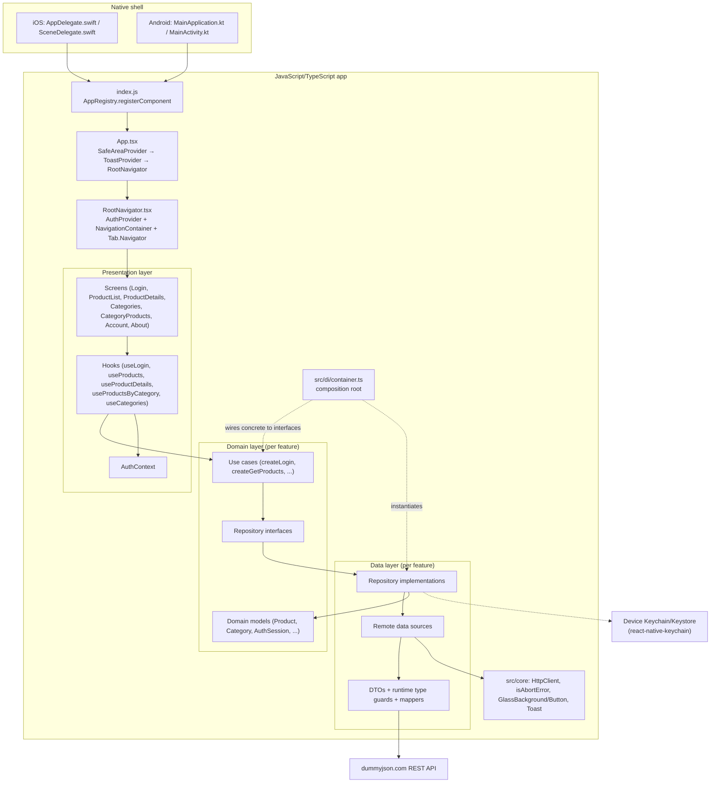
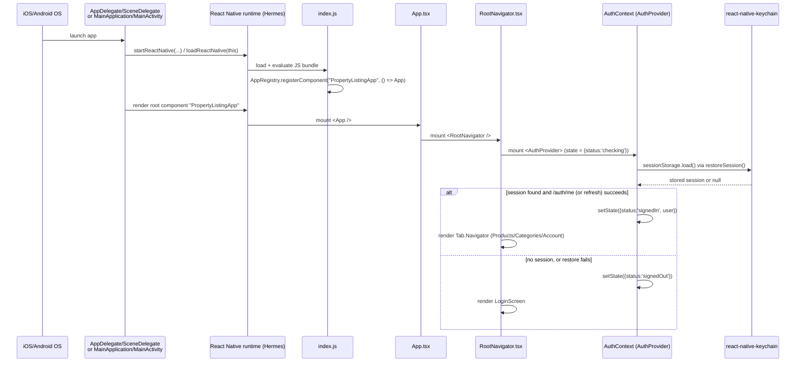
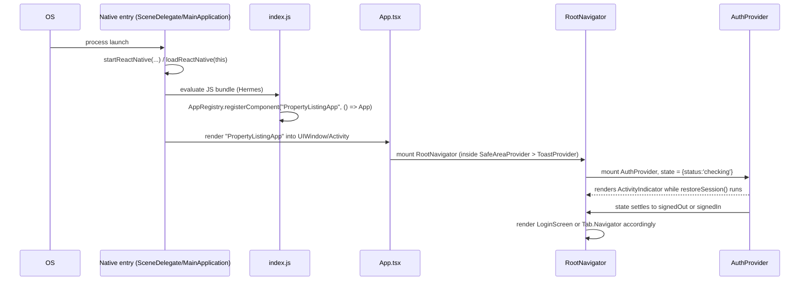
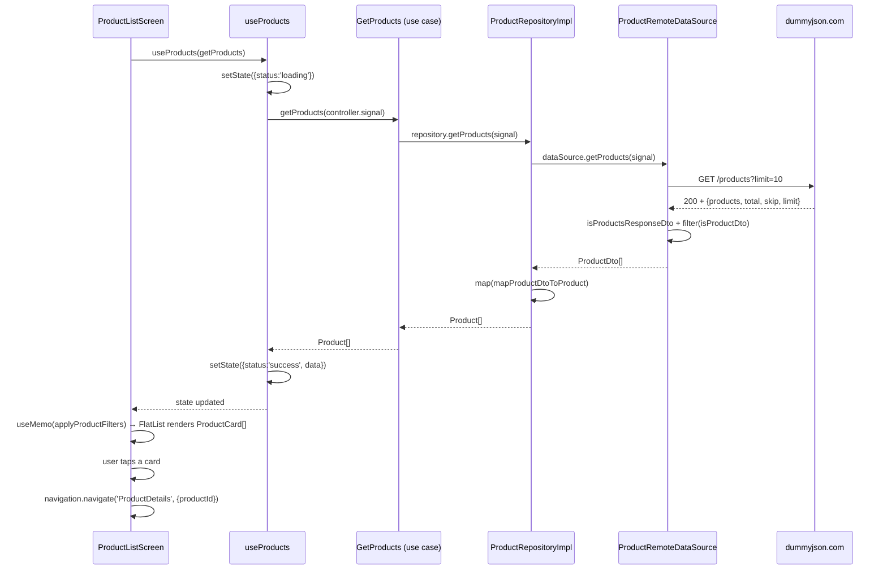
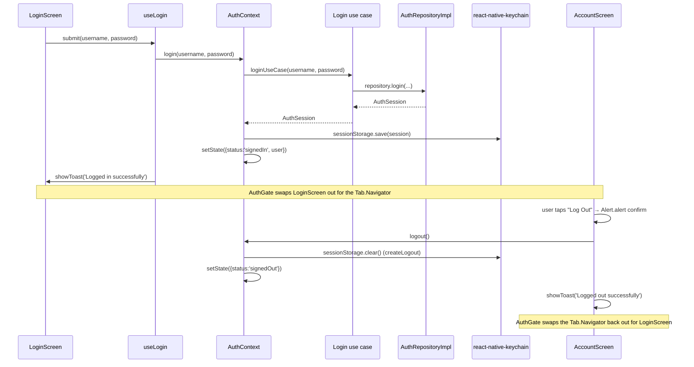

# React Native Architecture Guide — PropertyListingApp

A from-the-source walkthrough of this repository, written for an experienced iOS/Swift/UIKit/SwiftUI developer who is new to React Native. Every claim below was verified against the actual files in this repo on 2026-10-28 (updated after the product/category UI redesign, the full product-details rewrite, and the category-product pagination feature landed); where something could not be verified (no such file, or behavior not implemented), that is stated explicitly rather than assumed.

## Executive Summary

PropertyListingApp is a React Native 0.88 / TypeScript / React Native CLI (not Expo) app. It is called "PropertyListingApp" and its UI is styled as a property-listing app ("Properties", "Property Details"), but **the data it consumes is DummyJSON's generic e-commerce product/category API** — there is no real estate backend. It has a login screen (backed by `https://dummyjson.com/auth`), three bottom tabs (Products, Categories, Account) each with their own native-stack navigator, and a "Liquid Glass" visual treatment that activates only on iOS 26+.

Architecturally, each feature (`auth`, `products`, `categories`) is organized into three layers — **domain** (models, repository interfaces, use-case factory functions), **data** (DTOs, runtime type guards, mappers, concrete repositories, a remote data source), and **presentation** (hooks, screens, one shared context). A single composition root, [`src/di/container.ts`](../src/di/container.ts), wires concrete data-layer implementations to the use cases the UI consumes. This is the same shape as iOS Clean Architecture / Repository pattern work you already know — the terminology (`AuthRepository`, `GetProducts` use case, DTO→domain mapper) will be familiar even though the language is TypeScript instead of Swift.

There is **no Redux/MobX/Zustand**, **no AsyncStorage** (sessions go to the Keychain/Keystore via `react-native-keychain`), **no GraphQL/Apollo/axios** (a hand-written `HttpClient` wrapper over the global `fetch`), and **no formal MVVM naming** — but the custom hooks (`useProducts`, `useLogin`, etc.) do the job a SwiftUI `ObservableObject` view model would do: own the screen's state, run the effect, expose a retry function.

### Suggested reading order

1. Section 1 (Project Overview) and Section 3 (Startup Lifecycle) — the big picture.
2. Section 6 (Navigation) — needed to make sense of every screen.
3. Section 7 (Networking and API Data Flow) — the request pattern repeats everywhere.
4. Section 5 (Deep Dive Into Every Screen) and Section 11 (Auth Flow) — read alongside the actual files.
5. Section 16 (Architecture Assessment) and Section 17 (Learning Roadmap) last, once the rest has sunk in.

### Most important files to understand first

- [`App.tsx`](../App.tsx) — composition root for providers.
- [`src/di/container.ts`](../src/di/container.ts) — the whole app's dependency graph in one file.
- [`src/app/navigation/navigators/RootNavigator.tsx`](../src/app/navigation/navigators/RootNavigator.tsx) — auth gate + tab navigator.
- [`src/app/navigation/types.ts`](../src/app/navigation/types.ts) — every route and its params.
- [`src/features/products/presentation/hooks/useProducts.ts`](../src/features/products/presentation/hooks/useProducts.ts) — the canonical "load data into a screen" pattern, repeated (with small variations) by `useProductDetails`, `useProductsByCategory`, `useCategories`.
- [`src/features/auth/presentation/context/AuthContext.tsx`](../src/features/auth/presentation/context/AuthContext.tsx) — the one piece of cross-screen shared state in the app.

### What could not be verified / does not exist

- There is no `app.config.js`, no Expo config of any kind — confirmed: this is React Native CLI, not Expo.
- There is no `__mocks__/react-native-webview.js` in the repo (the background-session note that flagged this as "may be stale" was right to flag it — it does not exist now; nothing in the source imports `react-native-webview`).
- No Redux/Context-based global store beyond `AuthContext`; no persistence library beyond `react-native-keychain`.
- No end-to-end/Detox tests, no navigation-specific test utilities beyond what React Navigation itself provides in `__tests__/`.

---

## Table of Contents

1. [Project Overview](#section-1-project-overview)
2. [Complete Folder Structure](#section-2-complete-folder-structure)
3. [Application Entry Point and Startup Lifecycle](#section-3-application-entry-point-and-startup-lifecycle)
4. [Application Architecture and Responsibilities](#section-4-application-architecture-and-responsibilities)
5. [Deep Dive Into Every Existing Screen](#section-5-deep-dive-into-every-existing-screen)
6. [Navigation Explained Using This Project](#section-6-navigation-explained-using-this-project)
7. [Networking and API Data Flow](#section-7-networking-and-api-data-flow)
8. [React Components, Props, and State](#section-8-react-components-props-and-state)
9. [TypeScript in This Codebase](#section-9-typescript-in-this-codebase)
10. [Styling and Native iOS Behavior](#section-10-styling-and-native-ios-behavior)
11. [Authentication and Account Flow](#section-11-authentication-and-account-flow)
12. [Error Handling and Reliability](#section-12-error-handling-and-reliability)
13. [End-to-End Execution Traces](#section-13-end-to-end-execution-traces)
14. [How to Add a New Feature](#section-14-how-to-add-a-new-feature)
15. [Testing and Debugging](#section-15-testing-and-debugging)
16. [Architecture Assessment](#section-16-architecture-assessment)
17. [React Native Learning Roadmap](#section-17-react-native-learning-roadmap)
18. [Glossary and iOS-to-React-Native Mapping](#section-18-glossary-and-ios-to-react-native-mapping)

---

## Section 1: Project Overview

**What it does.** A mobile app, branded "PropertyListingApp" / "Properties", that requires login, then lets the user browse a product list, filter/sort it, browse by category, and view product details — all backed by the public [DummyJSON](https://dummyjson.com) API (`/auth/*`, `/products`, `/products/categories`). This is placeholder e-commerce data wearing real-estate copy ("Property Details", "Properties" tab title) — there is no listings/bedrooms/location data anywhere in the models.

**Version/tooling** (from [`package.json`](../package.json)):
- `react-native`: `0.88.0`, `react`: `19.3.0`.
- TypeScript `^6.0.3`, config extends `@react-native/typescript-config` ([`tsconfig.json`](../tsconfig.json)).
- **React Native CLI**, not Expo: scripts are `react-native run-android` / `run-ios` / `start`, dependencies include `@react-native-community/cli*`, and there is a real `android/` and `ios/` native project checked into the repo. No `expo` package anywhere in `package.json`.
- `android/gradle.properties` has `newArchEnabled=true` and `hermesEnabled=true` — the app runs on React Native's New Architecture (Fabric/TurboModules) with the Hermes JS engine, both of which are RN 0.88's defaults.

**Navigation**: [`@react-navigation/native`](https://reactnavigation.org) v7 + [`@react-navigation/native-stack`](https://reactnavigation.org/docs/native-stack-navigator) v7 for the three per-tab stacks, plus [`@bottom-tabs/react-navigation`](https://github.com/callstack/react-native-bottom-tabs) (built on `react-native-bottom-tabs`) for the root tab bar — this renders a **real native** `UITabBarController` (iOS) / Material `BottomNavigation` (Android), not a JS-drawn tab bar.

**Networking**: no library — a 5-line `HttpClient` interface (`src/core/network/HttpClient.ts`) wrapping the global `fetch`, implemented once (`FetchHttpClient.ts`) and passed down through the DI container so tests can substitute a fake.

**State management**: local component state (`useState`) inside custom hooks, one `React.createContext` (`AuthContext`) for the only genuinely cross-screen state (who's logged in). No Redux, MobX, Zustand, Recoil, or Jotai anywhere in `package.json` or the source tree.

**Storage**: `react-native-keychain` — the session (`AuthSession`: tokens + user) is persisted to the OS Keychain/Keystore, never `AsyncStorage` and never a plaintext file.

**UI libraries**: `react-native-safe-area-context`, `react-native-screens` (used directly for its `sheetAllowedDetents`/`sheetGrabberVisible` native formSheet props), `@callstack/liquid-glass` (iOS 26+ "Liquid Glass" materials), `@react-native-vector-icons/material-icons`, `react-native-inappbrowser-reborn`.

**Architectural patterns actually present**: a layered, feature-based structure that mirrors **Clean Architecture's dependency rule** (domain has zero imports from data or presentation; data depends on domain; presentation depends on domain's types and the DI container's use-case instances) plus the **Repository pattern** and a **manual composition-root DI container**. This is not Redux/Flux, and it is not formally named "MVVM" or "Clean Architecture" anywhere in the code — those labels are this report's characterization of what the file layout and dependency direction actually do, not a framework the project imports.

### Architecture diagram



---

## Section 2: Complete Folder Structure

```
property-listing-app/
├── App.tsx                        # Root React component: providers + RootNavigator
├── index.js                       # Native-to-JS entry point (AppRegistry.registerComponent)
├── app.json                       # App name used by index.js and native projects
├── package.json                   # Dependencies, scripts (android/ios/start/lint/test)
├── tsconfig.json                  # Extends @react-native/typescript-config
├── babel.config.js                # Single preset: module:@react-native/babel-preset
├── metro.config.js                # Metro bundler config (default RN config, unmodified)
├── jest.config.js                 # Jest preset + transformIgnorePatterns + font-file transform
├── .eslintrc.js / .prettierrc.js  # Lint/format rules (extends @react-native config)
├── __mocks__/                     # Jest manual mocks for native-backed modules
│   ├── @callstack/liquid-glass.js
│   └── react-native-inappbrowser-reborn.js
├── __tests__/                     # Jest tests, mirrors src/ by feature/layer
│   ├── App.test.tsx
│   └── features/{auth,categories,products}/...
│       # products/presentation/ includes useProductsByCategory.test.tsx,
│       # a dedicated hook test for the pagination/race/concurrency behavior
├── android/                        # Native Android project (Kotlin, Gradle)
│   └── app/src/main/java/com/propertylistingapp/
│       ├── MainActivity.kt
│       └── MainApplication.kt
├── ios/                            # Native iOS project (Swift, Xcode/CocoaPods)
│   └── PropertyListingApp/
│       ├── AppDelegate.swift
│       └── SceneDelegate.swift
└── src/
    ├── app/navigation/
    │   ├── navigators/
    │   │   ├── RootNavigator.tsx       # Auth gate + bottom-tab navigator
    │   │   ├── ProductsNavigator.tsx   # Products tab's own native stack
    │   │   ├── CategoriesNavigator.tsx # Categories tab's own native stack
    │   │   └── AccountNavigator.tsx    # Account tab's own native stack
    │   ├── shared/
    │   │   ├── glassHeaderScreenOptions.tsx  # isGlassHeaderActive, glassHeaderScreenOptions
    │   │   └── layoutInsets.ts               # useOptionalHeaderHeight, useGlassScrollInsets
    │   └── types.ts                    # Every stack/tab's route-param types
    ├── core/
    │   ├── network/
    │   │   ├── HttpClient.ts           # Interface: { fetch(input, init): Promise<Response> }
    │   │   └── FetchHttpClient.ts       # Production impl, backed by global fetch
    │   ├── errors/
    │   │   └── isAbortError.ts         # True for AbortController-cancelled errors
    │   └── ui/
    │       ├── GlassBackground.tsx      # Liquid Glass surface / translucent fallback
    │       ├── GlassButton.tsx          # Secondary-action button, same glass/fallback split
    │       ├── Toast.tsx                # ToastProvider + useToast, app-wide status toasts
    │       └── usePulseOpacity.ts       # Looping 0.4↔1 opacity Animated.Value, shared by
    │                                    # every skeleton-loading placeholder
    ├── di/
    │   └── container.ts                # Composition root: wires HttpClient → data source →
    │                                    # repository → use cases, exported as `container`
    ├── assets/icons/                   # products.png / categories.png / account.png (Android tab icons)
    └── features/
        ├── auth/
        │   ├── domain/{models,repositories,usecases}/
        │   ├── data/{dto,mappers,datasources,repositories,storage}/
        │   ├── presentation/{context,hooks,screens}/
        │   └── index.ts                # Feature's public surface (barrel export)
        ├── categories/
        │   ├── domain/{models,repositories,usecases}/
        │   ├── data/{dto,mappers,datasources,repositories}/
        │   ├── presentation/
        │   │   ├── hooks/, screens/
        │   │   └── components/CategoryTileSkeleton.tsx   # Pulsing grid-tile placeholder
        │   └── index.ts
        └── products/
            ├── domain/
            │   ├── models/ (Product, ProductDetails, ProductFilters, ProductsPage, ...)
            │   ├── repositories/, usecases/, applyProductFilters.ts
            ├── data/{dto,mappers,datasources,repositories}/
            ├── presentation/
            │   ├── hooks/, screens/
            │   └── components/
            │       ├── ProductCard.tsx            # Shared list-row card
            │       └── ProductCardSkeleton.tsx     # Pulsing placeholder for the same shape
            └── index.ts
```

### Root configuration files

| File | Responsibility | Depended on by |
|---|---|---|
| [`package.json`](../package.json) | Declares dependencies/devDependencies and the `android`/`ios`/`start`/`lint`/`test` scripts; `react-native run-android`/`run-ios` read it to find the project name. | Every tool (Metro, Jest, native build systems) |
| [`index.js`](../index.js) | The one file the native side calls into: registers `App` as the component for `app.json`'s `name`. | Native `MainActivity`/`SceneDelegate` (indirectly, via the bundler) |
| [`app.json`](../app.json) | `{ name, displayName }` — the app's registered component name and native-visible display name. | `index.js`; the Xcode/Gradle native projects (project names already baked in at native-project-generation time) |
| [`tsconfig.json`](../tsconfig.json) | Extends RN's shared TS config; scopes type-checking to `**/*.ts(x)` excluding `node_modules`/`Pods`. | `npx tsc --noEmit`, editor tooling |
| [`babel.config.js`](../babel.config.js) | One preset (`module:@react-native/babel-preset`) that teaches Babel JSX + TS + RN's Flow-typed internals. | Metro (bundling) and Jest (test transforms) both run source through this |
| [`metro.config.js`](../metro.config.js) | Merges RN's default Metro config with (currently empty) local overrides. | Metro dev server / bundler |
| [`jest.config.js`](../jest.config.js) | Extends `@react-native/jest-preset`; widens `transformIgnorePatterns` so React Navigation/`react-native-screens`/`react-native-bottom-tabs` (which ship untranspiled ESM) get transformed; adds a font-file (`.ttf`) asset transform for `@react-native-vector-icons`. | `npx jest` |
| [`.eslintrc.js`](../.eslintrc.js) / [`.prettierrc.js`](../.prettierrc.js) | Lint/format rules, both just extending `@react-native`'s shared config. | `npm run lint` |

### `src/app/navigation/`

Centralizes everything about *how screens are organized*, separate from the screens themselves. `types.ts` is read by every navigator and every screen that calls `useNavigation`/`useRoute` — it's the single source of truth for "what routes exist and what params they take" (detailed in Section 6). `shared/` holds the two small pieces of navigation-adjacent logic shared by all three stacks: whether the Liquid Glass header treatment is active, and how a screen should pad itself to sit under a transparent header.

### `src/core/`

Cross-feature code with no feature-specific knowledge. `network/HttpClient.ts` is an interface, not an implementation — this is what lets `src/di/container.ts` be the only file that ever imports the real `fetch`-backed client, and what lets tests pass in a `jest.fn()`-based fake instead. `errors/isAbortError.ts` is a 3-line type guard, duplicated in spirit by nothing else, imported by every hook and every remote data source that needs to tell "the user navigated away" apart from "the request actually failed." `ui/` holds the shared UI primitives: `GlassBackground` (used by `glassHeaderScreenOptions.tsx` as a header background), `GlassButton` (used by `AccountScreen`'s logout button, every list/details screen's retry button(s), and `ProductFiltersScreen`'s apply button), `Toast` (mounted once in `App.tsx`, consumed via `useToast()` by `useLogin` and `AccountScreen`), and `usePulseOpacity` — a tiny hook (a looping `Animated.timing` sequence from opacity `0.4` to `1`) with no UI of its own, used by both `ProductCardSkeleton` and `CategoryTileSkeleton` so the "pulse" animation is written once rather than copy-pasted into each skeleton component.

### `src/di/container.ts`

The **composition root**: the one place in the app allowed to `new` up — or in this functional-factory style, call the `create*` factory functions for — concrete implementations (`fetchHttpClient`, `createProductRemoteDataSource`, `createProductRepository`, `createSecureSessionStorage`, etc.) and wire them together. It exports a single `container` object whose values are *use-case functions* (e.g. `container.getProducts`), never repositories or data sources directly. Every navigator (`ProductsNavigator`, `CategoriesNavigator`, `RootNavigator`) imports `container` and passes the relevant use-case down into a screen as a prop. This is the direct equivalent of a Swift app wiring concrete services into protocol-typed properties at the composition root (e.g. in `SceneDelegate` or an `AppDependencies` struct) instead of screens calling `URLSession.shared` directly.

### `src/features/{auth,categories,products}/`

Each feature is a vertical slice with its own `domain/`, `data/`, and `presentation/` folders (described in full in Section 4), plus an `index.ts` barrel file that is the *only* import path other code is meant to use (e.g. `ProductsNavigator` imports `ProductListScreen` from `'../../../features/products'`, never by reaching into `products/presentation/screens/ProductListScreen` directly). This barrel also controls what's exported at all — e.g. `products/index.ts` does not export `ProductRemoteDataSource` or `ProductRepositoryImpl`, so nothing outside `src/di/container.ts` can accidentally depend on the concrete data layer.

### `android/` and `ios/`

Standard React Native CLI native projects (not auto-generated on each build — they're checked into the repo and hand-edited when needed, e.g. for the app icon changes visible in this session's git status). `android/app/src/main/java/com/propertylistingapp/MainActivity.kt` and `MainApplication.kt`, and `ios/PropertyListingApp/AppDelegate.swift` and `SceneDelegate.swift`, are the files that matter for understanding startup (Section 3) — the rest (Gradle files, `Podfile`, asset catalogs, `Info.plist`) are native build configuration this report does not re-document file by file.

---

## Section 3: Application Entry Point and Startup Lifecycle

### The files, in the order they matter

1. **`app.json`** — compile/package-time only. `{ "name": "PropertyListingApp", "displayName": "PropertyListingApp" }`. Read by `index.js` to know what string to register the root component under.
2. **`index.js`** — the actual JS entry point Metro bundles first:
   ```js
   import { AppRegistry } from 'react-native';
   import App from './App';
   import { name as appName } from './app.json';

   AppRegistry.registerComponent(appName, () => App);
   ```
   `AppRegistry.registerComponent` doesn't render anything by itself — it just tells React Native's native bridge "when the native side asks for a component named `PropertyListingApp`, here's the factory function that produces it." Nothing renders until the native side calls in.
3. **Native iOS entry** — [`ios/PropertyListingApp/AppDelegate.swift`](../ios/PropertyListingApp/AppDelegate.swift) is now nearly empty (`@main`, `application(_:didFinishLaunchingWithOptions:)` just returns `true`); on RN's New-Architecture-era template, the real work moved to **`SceneDelegate.swift`**, which is where React Native actually boots:
   ```swift
   dependencyProvider = RCTAppDependencyProvider()
   reactNativeFactory = RCTReactNativeFactory(delegate: self)
   window = UIWindow(windowScene: windowScene)
   reactNativeFactory?.startReactNative(
     withModuleName: "PropertyListingApp",
     in: window,
     connectionOptions: connectionOptions
   )
   ```
   `startReactNative(withModuleName:in:connectionOptions:)` is the call that starts the JS engine (Hermes), loads the bundle from `bundleURL()` (Metro's dev server in `#if DEBUG`, or `main.jsbundle` in a release build), and tells it to render the component registered under `"PropertyListingApp"` — exactly the name `index.js` registered.
4. **Native Android entry** — [`MainApplication.kt`](../android/app/src/main/java/com/propertylistingapp/MainApplication.kt)'s `reactHost` lazily builds the React Native host (`getDefaultReactHost`) and `onCreate()` calls `loadReactNative(this)`; [`MainActivity.kt`](../android/app/src/main/java/com/propertylistingapp/MainActivity.kt)'s `getMainComponentName()` returns `"PropertyListingApp"` — again, the same name — and its `createReactActivityDelegate()` wires up Fabric (`fabricEnabled`, read from `android/gradle.properties`'s `newArchEnabled=true`).
5. **`App.tsx`** — the first JS-authored component to actually render:
   ```tsx
   function App() {
     const isDarkMode = useColorScheme() === 'dark';
     return (
       <SafeAreaProvider>
         <StatusBar barStyle={isDarkMode ? 'light-content' : 'dark-content'} />
         <AppContent />
       </SafeAreaProvider>
     );
   }
   function AppContent() {
     return (
       <View style={styles.container}>
         <ToastProvider>
           <RootNavigator />
         </ToastProvider>
       </View>
     );
   }
   ```
   Provider order, outside-in: `SafeAreaProvider` (so any descendant can read safe-area insets) → `ToastProvider` (so any descendant can call `useToast()`) → `RootNavigator` (auth + navigation, Section 6). There is no Redux `<Provider>`/React Query `<QueryClientProvider>` here — confirming no global state library beyond this feature-local set.
6. **`RootNavigator`** wraps `AuthProvider` (built from `container.login`/`container.logout`/`container.restoreSession`/`container.sessionStorage`) around a single `NavigationContainer`, inside which `AuthGate` reads `useAuth().state.status` and renders one of three things: an `ActivityIndicator` (`'checking'`), `LoginScreen` (`'signedOut'`), or the `Tab.Navigator` (`'signedIn'`). This is the first rendered screen, and which of the three it is depends on whether a session was found and successfully validated/refreshed in the Keychain (see Section 11).

### Sequence diagram



### Runtime vs. compile-time vs. native-build-time

- **Native build time** (Xcode/Gradle, once per native change): compiles `AppDelegate.swift`/`SceneDelegate.swift`/`MainActivity.kt`/`MainApplication.kt` and all native dependencies into the actual `.app`/`.apk`; bakes in whatever `app.json`-derived display name/icon was set at template-generation/edit time.
- **TypeScript compile time** (`npx tsc --noEmit`, or your editor): type-checks `.ts`/`.tsx` files against `tsconfig.json`'s rules; produces **no runtime artifact** — Metro doesn't invoke `tsc` to bundle, it uses Babel (via `babel.config.js`'s `@react-native/babel-preset`) to strip types, which happens whether or not the types are valid. A type error does not stop the app from running in dev the way a Swift compile error stops a build.
- **Runtime** (every app launch, and every Metro refresh in dev): `index.js` executing, `App`/`RootNavigator`/`AuthProvider` mounting, the `/auth/me` or `/auth/refresh` network call actually happening, screens actually rendering.

---

## Section 4: Application Architecture and Responsibilities

Each feature folder has three layers. This is consistent across `auth`, `categories`, and `products` — the same shape repeats three times with different domain content.

### Domain layer (`features/*/domain/`)

- **Responsibility**: define what the feature *means*, independent of any API or UI — models (`Product`, `Category`, `AuthSession`), repository *interfaces* (`ProductRepository`, `CategoryRepository`, `AuthRepository`, `AuthSessionStorage`), and use-case factory functions (`createGetProducts`, `createLogin`, ...).
- **Inputs**: nothing from the outside world directly — a use case takes a repository (satisfying its interface) as a constructor argument and returns a narrow function type (e.g. `GetProducts = (signal?: AbortSignal) => Promise<Product[]>`).
- **Outputs**: domain models and these narrow use-case function types.
- **Dependencies**: none on `data/` or `presentation/` — verified by reading every file in every feature's `domain/` folder; none import from a sibling `data/` or `presentation/` path.
- **Relationship to other layers**: `data/` implements these interfaces; `presentation/` calls the use-case functions (never a repository or DTO directly).
- One domain-only piece of actual logic exists: [`applyProductFilters.ts`](../src/features/products/domain/applyProductFilters.ts), a pure function (sort/filter products client-side) with no I/O — correctly placed in `domain/` rather than a hook, since it has nothing to do with React.

### Data layer (`features/*/data/`)

- **Responsibility**: talk to the outside world (HTTP) and translate its shape into the domain's shape. Split into `dto/` (the wire format plus a runtime type guard, e.g. `isProductDto`), `mappers/` (pure DTO→domain functions, e.g. `mapProductDtoToProduct`), `datasources/` (the actual `fetch` calls + response validation, returning DTOs), and `repositories/` (the concrete class/factory implementing the domain's repository interface, calling the data source then mapping).
- **Inputs**: an `HttpClient` (for remote data sources) or nothing (storage).
- **Outputs**: domain models (from repositories) or DTOs (from data sources, internal to this layer).
- **Dependencies**: `core/network`, `core/errors`, and the *same feature's* `domain/` (to know what interface to implement and what model to map into). Never another feature's data layer.
- Auth's `data/storage/SecureSessionStorage.ts` is the one data-layer piece with no remote component — it implements `AuthSessionStorage` entirely against `react-native-keychain`.

### Presentation layer (`features/*/presentation/`)

- **Responsibility**: screens (what's rendered), hooks (state + effect management per screen, taking a use-case function as a parameter), one context (`AuthContext`, the one piece of state genuinely shared across screens/features), and one shared component (`ProductCard`).
- **Inputs**: a use-case function (as a prop, e.g. `ProductListScreenProps.getProducts: GetProducts`) plus navigation route params.
- **Outputs**: rendered UI; navigation calls (`navigation.navigate(...)`).
- **Dependencies**: the feature's own `domain/` (models, use-case types) and `src/core/ui`/`src/app/navigation/shared` for cross-cutting UI concerns. Screens never import a repository, a DTO, or a remote data source — confirmed by inspecting every screen file; the only data-layer-adjacent import any screen has is the *type* of a use-case function, which lives in `domain/usecases/`.

### Cross-cutting layers

- **Navigation** (`src/app/navigation/`): not feature-owned — it imports from features (`ProductsNavigator` imports `ProductListScreen`, `ProductDetailsScreen`, etc. from `'../../../features/products'`) but no feature imports back from navigation except for route-param *types* (`ProductDetailsParams`, `CategoriesStackParamList`, `AccountStackParamList`) and the two shared hooks (`useOptionalHeaderHeight`, `useGlassScrollInsets`).
- **State management / context**: exactly one context exists (`AuthContext`). Every other piece of "state" in the app is local `useState` inside a hook, scoped to the screen that uses it (e.g. `ProductsNavigator`'s own `useState<ProductFilters>` for the current filter selection — note this lives in the *navigator*, not a screen, specifically so the filter screen can mutate it via a plain prop callback rather than through serializable navigation params).
- **Application logic / hooks**: `useLogin`, `useProducts`, `useProductDetails`, `useProductsByCategory`, `useCategories` — each owns one `useState` state machine (`'loading' | 'success' | 'error'`, or for login, `'idle' | 'loading' | 'error'`) and one `useEffect` that fires the use-case call, with `AbortController` cancellation and an `isActive` guard flag (see Section 7 for why both are needed).
- **Type definitions**: `src/app/navigation/types.ts` (navigation) plus each feature's `domain/models/*`.
- **Platform-specific behavior**: `Platform.OS` checks (icon source in `RootNavigator`, `KeyboardAvoidingView` behavior in `LoginScreen`, safe-area edges in `ProductFiltersScreen`) and the `isLiquidGlassSupported`/`isGlassHeaderActive` gate (iOS 26+ only; Android and older iOS get a different, explicitly-coded fallback — not a native-API absence silently doing nothing).

### What is *not* a layer here (to avoid over-claiming)

- There is no separate "service" layer distinct from the repository — use cases call repositories directly.
- There is no view-model class — the hooks fill that role, but they are plain functions returning `{ state, retry }` or `{ state, submit }`, not classes, and are not named "ViewModel" anywhere.
- There is no "middleware" or interceptor layer for the `HttpClient` (e.g. no automatic auth-header injection, no automatic 401→refresh retry at the HTTP-client level) — the one place that *does* retry after a refresh is `RestoreSession`'s use case, which is feature-specific logic, not a generic client feature.

---

## Section 5: Deep Dive Into Every Existing Screen

### LoginScreen — [`src/features/auth/presentation/screens/LoginScreen.tsx`](../src/features/auth/presentation/screens/LoginScreen.tsx)

- **Responsibility**: username/password form; the signed-out experience rendered by `AuthGate` in `RootNavigator` (not a navigable route — there is no `'Login'` entry in any `*StackParamList`).
- **Imports/dependencies**: only `useLogin()` from its own feature; no navigation prop, no props at all — `export function LoginScreen()` takes zero arguments.
- **Props/TS types**: none. All state is local.
- **State and effects**: three `useState`s — `username: string`, `password: string`, `passwordVisible: boolean` — plus whatever `useLogin()` returns (`state: LoginFormState`). No `useEffect` in this file.
- **Event handlers**: `onChangeText` for both fields, a show/hide-password `Pressable`, and the submit `Pressable`'s `onPress={() => submit(username, password)}`.
- **Data flow in**: nothing — it's the entry screen.
- **Loading/error rendering**: `isLoading = state.status === 'loading'` disables both inputs and swaps the button's `Text` for an `ActivityIndicator`; `state.status === 'error'` renders `state.message` in red above the button. There is no explicit empty state (not applicable to a form) and no "success" render — success unmounts this screen entirely, since `AuthGate` swaps it out once `AuthContext`'s state becomes `'signedIn'`.
- **Reusable components used**: none from `core/ui` — this screen hand-rolls its own `TextInput`/`Pressable` styling rather than using `GlassButton`, unlike every other primary-action screen's retry buttons.
- **Navigation**: none — there's nowhere for this screen to navigate to.
- **User interactions**: type username/password, toggle password visibility, submit (disabled via `canSubmit` until both fields are non-empty and not already loading).
- **What's done well**: `canSubmit` guards against submitting empty fields client-side before even calling the use case; `useLogin`'s own guard (`if (state.status === 'loading') return;`) is a second, hook-level guard against double-submission.
- **What to study further**: this screen never resets `state` back to `'idle'` after an error if the user starts typing again — a failed login's error message will stay visible until the next submit attempt resolves. Confirm whether that's the intended UX by re-reading `useLogin.ts`.

### ProductListScreen — [`src/features/products/presentation/screens/ProductListScreen.tsx`](../src/features/products/presentation/screens/ProductListScreen.tsx)

- **Responsibility**: the Products tab's initial screen — fetch and render the product list, filtered/sorted by whatever `ProductFilters` the navigator currently holds.
- **Imports/dependencies**: `useNavigation` (typed `NativeStackNavigationProp<RootStackParamList, 'ProductsList'>`), `useGlassScrollInsets`, `applyProductFilters` (domain), `useProducts` (hook), `ProductCard` (component), `GlassButton` (core UI).
- **Props**: `{ getProducts: GetProducts; filters: ProductFilters }` — both injected by `ProductsNavigator`, neither created here.
- **State and effects**: all fetch state lives in `useProducts` (external to this file); this screen only derives `filteredData` via `useMemo(() => applyProductFilters(...), [state, filters])` — a pure, synchronous re-filter, not a new fetch, whenever either the fetched data or the filter selection changes.
- **Event handlers**: `renderItem`'s `onPress` navigates to `'ProductDetails'` with `{ productId: item.id }`; wrapped in `useCallback` keyed on `[navigation]` so `FlatList` doesn't get a new function identity every render.
- **Rendering by state**: loading → a column of four `ProductCardSkeleton` placeholders (not a spinner — see below) under an `accessibilityRole="progressbar"` wrapper; error → message + `GlassButton` "Retry" (calls `retry()` from the hook); success with `data.length === 0` → "No properties found right now" (server returned a genuinely empty list); success with data present but `filteredData.length === 0` → a *different* message, "No properties match these filters" (client-side filter is empty, data wasn't) — these are two distinct empty states, correctly distinguished.
- **Loading placeholder**: [`ProductCardSkeleton`](../src/features/products/presentation/components/ProductCardSkeleton.tsx) mirrors `ProductCard`'s exact layout (image block, price/favorite row, title, category, description row) as flat gray `View`s, all pulsing together via the shared `usePulseOpacity()` hook — this replaced an earlier plain `ActivityIndicator` + text loading state, so a first-time visitor sees the shape of the content that's about to arrive rather than a generic spinner.
- **Reusable components**: `ProductCard`, `ProductCardSkeleton`, `GlassButton`.
- **Navigation**: pushes `'ProductDetails'`.
```tsx
// src/features/products/presentation/screens/ProductListScreen.tsx
const filteredData = useMemo(
  () => (state.status === 'success' ? applyProductFilters(state.data, filters) : []),
  [state, filters],
);
```
This line is the entire "apply filters" feature: no second network call, no re-fetch on filter change — `applyProductFilters` is a pure in-memory sort/filter over data already loaded. The dependency array re-runs it only when the fetch result or the filter object changes, so toggling a filter is instant.

**`ProductCard`, the shared row component** — [`src/features/products/presentation/components/ProductCard.tsx`](../src/features/products/presentation/components/ProductCard.tsx), used by both `ProductListScreen` and `CategoryProductsScreen`: an image with two overlay badges (a bottom-right "★ {rating}" pill, and a top-right "Top Rated" pill shown only when `product.rating >= 4.5`, a local `TOP_RATED_THRESHOLD` constant — not a server-provided flag), then a body with a price/favorite-heart row, the title, the category, and a description row prefixed with a small `MaterialIcons` "description" glyph. The heart (`favorite`/`favorite-border` `MaterialIcons`, toggled by a local `isFavorited` `useState`) is **purely local, per-card UI state with no persistence and no backing feature** — tapping it flips the icon and nothing else; there is no `Favorites` domain model, repository, or use case anywhere in the codebase (confirmed by inspecting `src/features/products/domain/`), so don't mistake it for a real feature when reading the code.

### ProductDetailsScreen — [`src/features/products/presentation/screens/ProductDetailsScreen.tsx`](../src/features/products/presentation/screens/ProductDetailsScreen.tsx)

This screen was substantially rewritten to surface the *entire* DummyJSON product record (previously only title/description/price/discount/category/rating/brand/stock/availability/tags/images were modeled — see Section 7 for the data-layer side of this change). It is still the one screen shared verbatim between the Products and Categories tab stacks, typed the same minimal way as before: `NativeStackScreenProps<{ ProductDetails: ProductDetailsParams }, 'ProductDetails'> & { getProductDetails: GetProductDetails }`.

- **Image carousel** — a local `ImageCarousel` component (defined in the same file, not exported) wraps a horizontal, `pagingEnabled` `FlatList` over `state.data.images` (now guaranteed non-empty by the mapper's `images.length > 0 ? images : [thumbnail]` fallback). Each slide is rendered by a local `ImageSlide` component: it shows a pulsing gray placeholder (`usePulseOpacity()`) until the `Image`'s `onLoad` fires, and swaps to an "Image unavailable" fallback `View` on `onError` — the exact same loading/error split every other image in the app uses, just per-slide instead of per-screen. `ImageCarousel` tracks `activeIndex` via `onScroll`'s `contentOffset.x` divided by the (measured, via `useWindowDimensions`) screen width, and renders three overlays: a "{current} / {total}" counter top-right and a row of dot indicators bottom-center (both only when there's more than one image), and a "★ {rating}" badge bottom-right (always shown). There is **no discount badge on the image** — an earlier version paired a "-N%" badge with the rating top-right, but it was removed because it duplicated the discount badge already shown inline next to the price below; the two badges competing for the same corner was also the reason the rating badge moved to the opposite corner (bottom-right) instead of sharing the top with the page counter.
- **Price row**: current price, the strikethrough original price, and the discount badge render **inline on one row** (`styles.priceRow`) when `discountPercentage > 0`; a plain price `Text` otherwise. This replaced an earlier two-line layout (price on its own line, discount details stacked under it).
- **Chips row** (`styles.chipsRow`, directly under the price): the Category badge (same pastel-indigo pill as the rest of the app) and an Availability badge side by side — the Availability badge is new: a colored dot plus colored text on a tinted pill background, the tint/color pair chosen by `availabilityBackground`/`availabilityColor` (green and `#dcfce7` for "In Stock", amber and `#fef3c7` for "Low Stock", red and `#fee2e2` for "Out of Stock"), replacing a plain colored `Text` label.
- **Tags**: `state.data.tags` filtered to drop any tag that case-insensitively matches the category (so a "beauty"-category product tagged "beauty" doesn't show that word twice), then rendered as a **single muted gray text line** (`"tag1  ·  tag2"`, `styles.tagsRow`/`tagsRowText`) with a small `local-offer` `MaterialIcons` glyph in front — not as individual pill chips. An earlier iteration rendered each remaining tag as its own colored, then gray, pill; both were dropped because mixing colorful status badges with multiple separate pill boxes in one wrapping row read as cluttered, and a lone wrapped-to-its-own-line pill looked orphaned. Plain text wraps far more gracefully.
- **"Product details" and "Shipping & returns" cards**: two `styles.sectionCard` `View`s (white background, `borderRadius: 16`, a subtle `borderWidth: 1`/`#e5e7eb` border, and a small shadow), each built from a local `DetailRow({ icon, label, value, last? })` component — an icon, a label, and a right-aligned value, with a hairline bottom border on every row except the last (`!last && styles.detailRowBorder`). "Product details" lists SKU, Stock, Min. order, Weight, and Dimensions (formatted `"{width} × {height} × {depth}"`); "Shipping & returns" lists Shipping, Warranty, and Returns. **Weight and dimensions are shown as bare numbers with no invented unit** — DummyJSON documents no unit for either field, and the DTO file says so explicitly in a comment; the report (and the code) deliberately does not guess "g" or "cm".
- **Reviews section**: a header row showing `"Reviews ({state.data.reviews.length})"` alongside a `"★ {rating} / 5"` summary (this rating+count line used to sit up near the top, next to Availability, but was moved down here specifically so it sits beside the thing it's summarizing), followed by one `ReviewCard` per `state.data.reviews` entry — reviewer name, a star string from a local `reviewStars(rating)` helper (`'★'.repeat(full) + '☆'.repeat(5 - full)`), the comment, and a date formatted via `Intl.DateTimeFormat('en-US', { year: 'numeric', month: 'short', day: 'numeric' })`. `reviewerEmail` (present in the DTO) is dropped by the mapper and never reaches this screen — it's PII with no display use.
- **State and effects**: `navigation.setOptions({ title: state.data.title })` still fires in a `useEffect` keyed on `[state, navigation]` once the fetch succeeds, same as before — the header title isn't known at navigation time, only the id is. Each `ImageSlide` owns its own `status: 'loading' | 'loaded' | 'error'` `useState`, local to that slide (switching products via the carousel, or re-fetching, remounts the slides and resets this naturally).
- **Rendering by state**: the outer loading/error/success three-way split (and the `ActivityIndicator` + "Loading details…" loading state) is **unchanged** from before — this screen's own first-load state was not converted to a skeleton placeholder, unlike `ProductListScreen`/`CategoryProductsScreen`/`CategoriesScreen`.
- **What's implemented well**: discount math is still done inline (`price * (1 - discountPercentage / 100)`) and only rendered when `discountPercentage > 0`; the Availability badge's color/background pairing is driven by the same `availabilityStatus` string in both places, so the dot, the text, and the background tint can never disagree with each other.

### CategoriesScreen — [`src/features/categories/presentation/screens/CategoriesScreen.tsx`](../src/features/categories/presentation/screens/CategoriesScreen.tsx)

- **Responsibility**: list all product categories as a 2-column grid of tiles.
- **Props**: `{ getCategories: GetCategories }`.
- **Tile design**: each tile is a `Pressable` with a pastel `backgroundColor` and a matching, more-saturated `borderColor` (`accentFor(index)` now returns `{ bg, border, fg }`, cycled by the item's position — not hashed from the slug — so no two *adjacent* tiles share a color; the previous hash-based version could coincidentally repeat colors next to each other), a decorative oversized "blob" circle in one corner (`styles.tileBlob`, a semi-transparent white circle, positioned to peek out from behind the icon), a circular white "icon badge" (`styles.tileIconBadge`) containing a full-color **emoji** (not a `MaterialIcons` glyph), and the category name in bold navy text below. `emojiFor(slug)` looks the slug up in a `CATEGORY_EMOJIS` map (e.g. `beauty: '💄'`, `fragrances: '🌸'`, `laptops: '💻'`) with a `'🏷️'` fallback for any category DummyJSON might add that isn't in the map. Emoji were chosen specifically because they render as full-color system glyphs with no icon font or image asset needed, reading closer to a small illustrated sticker than a flat line icon does.
- **Loading placeholder**: [`CategoryTileSkeleton`](../src/features/categories/presentation/components/CategoryTileSkeleton.tsx) — a white tile (matching border/radius) with a gray circle and a gray bar, pulsing via the same shared `usePulseOpacity()` hook `ProductCardSkeleton` uses, replacing an earlier plain `ActivityIndicator` loading state. Six of them render (three rows of two) while the category list loads.
- **Navigation**: pushes `'CategoryProducts'` with `{ categorySlug, categoryName }` — passing the *name* along to avoid CategoryProductsScreen needing its own round trip just to set a header title (contrast with `ProductDetailsScreen`, which has no such shortcut available and must wait for its own fetch).

### CategoryProductsScreen — [`src/features/products/presentation/screens/CategoryProductsScreen.tsx`](../src/features/products/presentation/screens/CategoryProductsScreen.tsx)

- **Responsibility**: product list scoped to one category, now with **infinite-scroll pagination** — structurally close to `ProductListScreen` but with no filter support and no `applyProductFilters` call; it renders `state.data` directly, appended to as more pages load.
- **Props**: `NativeStackScreenProps<CategoriesStackParamList, 'CategoryProducts'> & { getProductsByCategory: GetProductsByCategory }` — `getProductsByCategory`'s type (`GetProductsByCategory`) gained `limit`/`skip` parameters and now returns a `ProductsPage` (`{ products, total }`) rather than a bare array; see Section 7 for the full pagination trace.
- **State**: `useProductsByCategory(categorySlug, getProductsByCategory)` returns the original `{ state, retry }` plus four new values — `loadMore` (a function), `isLoadingMore` (`boolean`), `loadMoreError` (`string | null`), and `hasMore` (`boolean`, unused directly by this screen but available). The screen itself holds no pagination state of its own; all of it lives in the hook (Section 7/16).
- **Infinite scroll wiring**: the `FlatList` has `onEndReached={loadMore}` and `onEndReachedThreshold={0.5}` (fires when the user has scrolled within half a screen-height of the end), plus a `ListFooterComponent={renderFooter}` — a small `useCallback`-memoized function that renders a centered `ActivityIndicator` while `isLoadingMore`, or (if `loadMoreError` is set) the error message plus a `GlassButton` "Retry" that just calls `loadMore()` again. When neither is true, the footer renders `null`.
- **First-page loading/error/empty rendering**: unchanged from before — a column of `ProductCardSkeleton` placeholders while `state.status === 'loading'`, `GlassButton` retry on `state.status === 'error'`, and the "No products found in this category" message when `state.status === 'success'` with an empty list. These are about the *first* page only; a failure loading page 2+ surfaces through the footer instead, never replacing the already-loaded list (Section 12).
- **What to study further**: this screen and `ProductListScreen` still share nearly all their first-page JSX/styles (loading/error/empty rendering, down to near-identical `StyleSheet` objects) despite sharing zero code between them — a long-standing candidate for extraction, now joined by the fact that neither screen's *pagination* logic is shared either (only `CategoryProductsScreen` paginates; `ProductListScreen` still fetches a single fixed page of 10 and stops) — see Section 16.

### AccountScreen — [`src/features/auth/presentation/screens/AccountScreen.tsx`](../src/features/auth/presentation/screens/AccountScreen.tsx)

- **Responsibility**: show the signed-in user's profile, link to About, link to Help (native in-app browser), and log out.
- **Props**: none — reads `useAuth()` directly.
- **Guard clause**: `if (state.status !== 'signedIn') return null;` — defensive, since this screen should only ever mount while signed in (it's one of the three root tabs, which only render once `AuthGate` has already decided `'signedIn'`), but written so a race can't crash it against `undefined` user data.
- **Event handlers**: `confirmLogout()` opens a native `Alert.alert` with Cancel/Log Out (destructive style) actions; `openHelp()` calls `InAppBrowser.open(HELP_URL)` with a `.catch(() => Linking.openURL(HELP_URL))` fallback if the in-app browser itself fails to open.
- **Navigation**: `useNavigation<NativeStackNavigationProp<AccountStackParamList, 'AccountHome'>>()`, used only for `navigation.navigate('About')` — "Need help?" deliberately does **not** go through navigation (see Section 6).
- **What's implemented well**: the logout confirmation dialog, and showing a toast only *after* `logout()` resolves (not optimistically).

### AboutScreen — [`src/features/auth/presentation/screens/AboutScreen.tsx`](../src/features/auth/presentation/screens/AboutScreen.tsx)

- **Responsibility**: static app-info screen (icon, name, version read live from `package.json`, a link to the repo).
- **Notable detail**: `import packageInfo from '../../../../../package.json'` then `packageInfo.version` — this is the one place in the app that reads build metadata directly rather than through a dedicated native module (e.g. `react-native-device-info`), which is fine for this purpose (no native version info like build number is shown) but worth knowing it will reflect `package.json`'s `version` field, not the native bundle's `CFBundleShortVersionString`/`versionName`, which could in principle diverge.

---

## Section 6: Navigation Explained Using This Project

### Hierarchy

```mermaid
flowchart TB
    Root["RootNavigator\n(NavigationContainer)"]
    AuthGate{"AuthGate\n(reads useAuth().state.status)"}
    Checking["ActivityIndicator\n(status: checking)"]
    Login["LoginScreen\n(status: signedOut)"]
    Tabs["Tab.Navigator\n(createNativeBottomTabNavigator)\n(status: signedIn)"]

    Root --> AuthGate
    AuthGate --> Checking
    AuthGate --> Login
    AuthGate --> Tabs

    Tabs --> ProductsTab["Products tab"]
    Tabs --> CategoriesTab["Categories tab"]
    Tabs --> AccountTab["Account tab"]

    subgraph PStack["ProductsNavigator (native-stack)"]
        PL["ProductsList\n(ProductListScreen)"]
        PF["ProductFilters\n(ProductFiltersScreen, formSheet)"]
        PD1["ProductDetails\n(ProductDetailsScreen)"]
        PL -->|navigate 'ProductFilters'| PF
        PL -->|navigate 'ProductDetails', {productId}| PD1
    end

    subgraph CStack["CategoriesNavigator (native-stack)"]
        CL["CategoriesList\n(CategoriesScreen)"]
        CP["CategoryProducts\n(CategoryProductsScreen)"]
        PD2["ProductDetails\n(ProductDetailsScreen, same component as PD1)"]
        CL -->|navigate 'CategoryProducts', {categorySlug, categoryName}| CP
        CP -->|navigate 'ProductDetails', {productId}| PD2
    end

    subgraph AStack["AccountNavigator (native-stack)"]
        AH["AccountHome\n(AccountScreen)"]
        AB["About\n(AboutScreen)"]
        AH -->|navigate 'About'| AB
    end

    ProductsTab --> PStack
    CategoriesTab --> CStack
    AccountTab --> AStack
```

### Navigator nesting and why

- **Root**: `Tab.Navigator` from `@bottom-tabs/react-navigation`'s `createNativeBottomTabNavigator` — a genuinely native tab bar, not `@react-navigation/bottom-tabs`'s JS-rendered one. `RootNavigator.tsx` sets `translucent={isLiquidGlassSupported}` and only overrides `tabBarStyle` with an opaque white background when Liquid Glass is *not* available (older iOS, and Android, whose Material `BottomNavigation` would otherwise render black under this app's non-Material theme).
- **Per-tab stacks**: each tab is itself a `createNativeStackNavigator` with its own `initialRouteName` and its own typed param list (`RootStackParamList` for Products, `CategoriesStackParamList` for Categories, `AccountStackParamList` for Account). This exists because `react-native-bottom-tabs` renders *only* the tab bar, not a header — each tab needs its own single-screen-or-more native stack purely to get a native header (confirmed by the code comment in `AccountNavigator.tsx`).
- **`ProductDetails` is registered twice** — once in `ProductsNavigator`, once in `CategoriesNavigator` — as the *same* `ProductDetailsScreen` component, so each tab keeps an independent navigation back-stack rather than hoisting details to one shared root-level route that both tabs would have to reach through cross-stack navigation.

### Route param types (`src/app/navigation/types.ts`)

```ts
export type ProductDetailsParams = { productId: string };

export type RootStackParamList = {
  ProductsList: undefined;
  ProductFilters: undefined;
  ProductDetails: ProductDetailsParams;
};

export type CategoriesStackParamList = {
  CategoriesList: undefined;
  CategoryProducts: { categorySlug: string; categoryName: string };
  ProductDetails: ProductDetailsParams;
};

export type AccountStackParamList = {
  AccountHome: undefined;
  About: undefined;
};

export type RootTabParamList = {
  Products: undefined;
  Categories: undefined;
  Account: undefined;
};
```

`ProductDetailsParams` is factored out and reused by *both* `RootStackParamList.ProductDetails` and `CategoriesStackParamList.ProductDetails` precisely so the two stacks' details routes stay in sync by construction — if the params ever need a new field, there is exactly one type to edit, and `ProductDetailsScreen`'s own prop type (`NativeStackScreenProps<{ ProductDetails: ProductDetailsParams }, 'ProductDetails'>`) is written against that shared type rather than either full stack list, which is what lets the identical component satisfy both stacks' differently-shaped `NativeStackScreenProps` without a cast. This is structural typing doing real work: TypeScript accepts `ProductDetailsScreen` in both navigators because its required props are a *subset* of what each stack actually provides, not because of any explicit interface declaration — closer to how a Swift protocol with a narrower requirement is satisfiable by many unrelated conforming types than to nominal subclassing.

### `navigate()` vs `push()`

This codebase uses `navigation.navigate(...)` exclusively (every call site: `ProductListScreen`, `CategoryProductsScreen`, `CategoriesScreen`, `AccountScreen`, `ProductsNavigator`'s filter button) — `.push()` does not appear anywhere. For stacks where each route only ever has one reachable "next" screen from a given point (list → details, list → filters), `navigate` and `push` behave the same; the distinction would only matter if the same screen could be pushed onto itself multiple times (e.g. "related products" linking to another `ProductDetails`), which doesn't happen here.

### How TypeScript catches invalid routes

Because `Stack.Navigator`/`Stack.Screen` are generic over the stack's param list (`createNativeStackNavigator<RootStackParamList>()`), and `useNavigation`/`NativeStackScreenProps` are explicitly parameterized with that same type in every screen and navigator, calling `navigation.navigate('ProductDetailz', ...)` (a typo) or omitting a required param (`navigation.navigate('ProductDetails')` with no `productId`) is a compile-time TypeScript error, not a runtime crash — `tsc --noEmit` catches it before the app ever runs. This is the direct equivalent of a Swift enum-based route/associated-value system catching an invalid case at compile time, except here it's structural (an object type), not a nominal `enum`.

### Header/platform-specific nav appearance

`glassHeaderScreenOptions` (shared by all three stacks via each `Stack.Navigator`'s `screenOptions` prop) is `{}` (no-op) unless `isGlassHeaderActive` (`Platform.OS === 'ios' && isLiquidGlassSupported`, i.e. iOS 26+) — in which case it sets `headerTransparent: true` and a `headerBackground` render prop returning `<GlassBackground />`. `AccountNavigator`'s `About` screen explicitly overrides this per-screen with `headerTransparent: false` since it's "a plain informational screen, not part of the glass design." `ProductsNavigator`'s `ProductFilters` screen overrides with `headerShown: false` entirely, since it supplies its own in-sheet header (see the `ProductFiltersScreen` deep dive).

---

## Section 7: Networking and API Data Flow

All networking funnels through one interface: [`HttpClient`](../src/core/network/HttpClient.ts) (`{ fetch(input, init): Promise<Response> }`), implemented once by [`fetchHttpClient`](../src/core/network/FetchHttpClient.ts) (just `{ fetch }`, the platform global). Every feature's remote data source takes an `HttpClient` as a constructor parameter rather than importing `fetch` directly — this is what makes the data sources unit-testable with a fake client (seen in `__tests__/features/products/data/ProductRepository.test.ts` and siblings).

### Pattern common to every endpoint (confirmed identical across `ProductRemoteDataSource`, `CategoryRemoteDataSource`, and `AuthRemoteDataSource`)

1. `httpClient.fetch(url, init)` inside a `try/catch` — a thrown `AbortError` (user navigated away / effect cleanup) is **re-thrown as-is**; every other thrown error (DNS failure, offline, etc.) is replaced with a generic `'Could not reach the server...'` `Error`.
2. `if (!response.ok) throw new Error(...)` — `fetch` only rejects on a true network failure; an HTTP error status (404, 500) still *resolves* successfully, so `.ok` must be checked explicitly (a common first-timer's mistake coming from platforms where a non-2xx status is more naturally an error path).
3. `response.json()` inside its own `try/catch`, since a response can claim JSON and fail to parse.
4. A **runtime type guard** (`isProductDto`, `isCategoryDto`, `isLoginResponseDto`, etc.) checks the parsed `unknown` value's actual shape before it's trusted as a typed DTO — this is the project's answer to "TypeScript types don't exist at runtime" (expanded in Section 9).
5. The repository (one layer up) calls the data source, then a pure mapper function (`mapProductDtoToProduct`, etc.) converts the validated DTO into the domain model.

### Trace: Product list (`GET https://dummyjson.com/products?limit=10`)

```
ProductListScreen (screen)
  → useProducts(getProducts)                                   [hook]
      useEffect → getProducts(controller.signal)                [GetProducts use case, src/features/products/domain/usecases/GetProducts.ts]
        → productRepository.getProducts(signal)                 [ProductRepositoryImpl, src/features/products/data/repositories/ProductRepositoryImpl.ts]
            → productRemoteDataSource.getProducts(signal)        [ProductRemoteDataSource, src/features/products/data/datasources/ProductRemoteDataSource.ts]
                → httpClient.fetch('https://dummyjson.com/products?limit=10', { signal })
                → validate envelope (isProductsResponseDto) + filter valid items (isProductDto)
            ← ProductDto[]
          mapProductDtoToProduct per item
      ← Product[]
  setState({ status: 'success', data })
ProductListScreen re-renders → useMemo(applyProductFilters) → FlatList renders ProductCard per item
  → tap a card → navigation.navigate('ProductDetails', { productId })
```

- **Where the URL/config is defined**: `PRODUCTS_URL = 'https://dummyjson.com/products'` and `LIST_URL = \`${PRODUCTS_URL}?limit=10\`` are constants local to `ProductRemoteDataSource.ts` — there is no centralized `Endpoints.ts`/environment-config file; each feature's data source hardcodes its own base URL constant. (This means there's no single place to swap environments — see Section 16.)
- **Cancellation**: `useProducts` creates an `AbortController` per effect run, passes `controller.signal` through the entire chain down to `fetch`, and calls `controller.abort()` in the effect's cleanup function (on unmount or before the next run). Separately, an `isActive` boolean flag guards the `.then`/`.catch` callbacks — this catches the narrower race where a response resolves *after* cleanup started but *before* the abort signal actually stops the download, which would otherwise let a stale response overwrite newer state.
- **Retry**: `useProducts` exposes `retry()`, which just increments a `retryCount` state value that's in the effect's dependency array — bumping it is the *only* thing that re-runs the fetch effect; there's no separate retry-specific code path.
- **Error/loading states**: three-state union (`'loading' | 'success' | 'error'`) rendered directly by the screen (Section 5), not stored anywhere beyond the hook's local `useState`.

### Trace: Product details, Categories

Structurally identical to the product-list trace above, each with its own hook (`useProductDetails`, `useCategories`) and its own use case (`GetProductDetails`, `GetCategories`), differing only in: `useProductDetails` adds the product id to the effect's dependency array (so switching the selected product correctly cancels the stale request and starts a fresh one), and `GetProductDetails`'s underlying endpoint is `GET https://dummyjson.com/products/{id}` with a pre-flight regex guard (`isValidProductId`, `/^\d+$/`) rejecting non-numeric ids before a request is even attempted. Categories hits `GET https://dummyjson.com/products/categories` (a bare array response, not the `{products, total, skip, limit}` envelope the product-list endpoints share).

### Trace: Category products — paginated

This is the one endpoint in the app with real pagination, and the request/response shape is genuinely different from every other trace in this document, so it gets its own walkthrough.

**Data layer.** `ProductRemoteDataSource.getProductsByCategory(categorySlug, limit, skip, signal?)` builds `GET https://dummyjson.com/products/category/{slug}?limit={limit}&skip={skip}` and returns `{ products, total }` — a `ProductsPageDto` — instead of a bare array. It shares its validation with the plain product list via the same internal `fetchProductsList` helper, which now always returns `{ products, total }`; `getProducts()` (the un-paginated list) just destructures `.products` and ignores `total`. `isProductsResponseDto` was tightened to also check `typeof candidate.total === 'number'` (previously it only checked that `products` was an array), since pagination now genuinely depends on that field being present and numeric. `ProductRepositoryImpl.getProductsByCategory` maps the DTO page into a domain `ProductsPage` (`{ products: Product[]; total: number }`, [`src/features/products/domain/models/ProductsPage.ts`](../src/features/products/domain/models/ProductsPage.ts)); `GetProductsByCategory` is, as with every other use case, a direct pass-through.

**`useProductsByCategory`'s pagination state.** The hook's existing `{ status: 'loading' | 'success' | 'error' }` union is untouched (so `CategoryProductsScreen`'s first-page rendering needed zero changes) — pagination is four *additional* pieces of state layered on top: `total` (`useState<number>`, reset to `0` whenever the category changes or `retry()` fires), `isLoadingMore`/`loadMoreError`, and `loadMore()`, a `useCallback`. The next page's `skip` is never tracked as its own variable — it's simply `state.data.length`, since "how many products are loaded" and "where the next page starts" are always the same number by construction (a successful page append only ever adds to the end, in order). `PAGE_SIZE` is a module-level `const` set to `10`, matching the plain product list's existing `?limit=10`.

```ts
// src/features/products/presentation/hooks/useProductsByCategory.ts
const loadMore = useCallback(() => {
  if (state.status !== 'success' || isLoadingMoreRef.current || state.data.length >= total) {
    return;
  }
  const requestedCategory = categorySlugRef.current;
  const skip = state.data.length;
  // ...fetch PAGE_SIZE starting at skip, append on success...
}, [state, total, getProductsByCategory]);
```

**Concurrency and staleness guards** (the part worth reading carefully, since none of this is visible from the UI):
- `isLoadingMoreRef` (a `useRef<boolean>`, not state) is checked *and* set synchronously at the top of `loadMore`, before any `setState` is scheduled. This is what actually stops a `FlatList` that fires `onEndReached` more than once in the same tick (common during fast scrolling) from starting two requests for the same page — a `useState`-based `isLoadingMore` flag alone couldn't guarantee this, because its updated value isn't visible to a second synchronous call until after a re-render.
- `categorySlugRef` is a ref kept in sync with the `categorySlug` prop on every render (`categorySlugRef.current = categorySlug`, written directly in the component body — not in an effect, since it just needs to mirror the latest prop, not react to its changes). `loadMore` captures the category it was called for (`categorySlugRef.current` at call time) and compares it against `categorySlugRef.current` again when the response arrives; if the user has since switched categories, the response is discarded instead of appending onto the new category's list.
- `loadMoreControllerRef` holds the `AbortController` for the in-flight "load more" request. The first-page effect's cleanup function — which already runs on category change or unmount — also aborts this controller, so switching away from a category genuinely cancels a page-2+ request in flight, not just ignores its eventual result.
- A failed `loadMore` sets `loadMoreError` but never touches `total` or appends anything to `state.data` — so the next call to `loadMore` (via the footer's "Retry" button) computes the exact same `skip` and retries the exact same page.

**Sequence** (first page, then one `loadMore`):

```mermaid
sequenceDiagram
    participant Screen as CategoryProductsScreen
    participant Hook as useProductsByCategory
    participant UC as GetProductsByCategory
    participant Repo as ProductRepositoryImpl
    participant DS as ProductRemoteDataSource
    participant API as dummyjson.com

    Screen->>Hook: useProductsByCategory(categorySlug, getProductsByCategory)
    Hook->>UC: getProductsByCategory(categorySlug, 10, 0, signal)
    UC->>Repo: repository.getProductsByCategory(categorySlug, 10, 0, signal)
    Repo->>DS: dataSource.getProductsByCategory(categorySlug, 10, 0, signal)
    DS->>API: GET /products/category/{slug}?limit=10&skip=0
    API-->>DS: 200 + {products, total}
    DS-->>Repo: {products: ProductDto[], total}
    Repo-->>UC: ProductsPage {products: Product[], total}
    UC-->>Hook: ProductsPage
    Hook->>Hook: setState({status:'success', data: products}); setTotal(total)
    Screen->>Screen: FlatList renders ProductCard[], user scrolls near the end
    Screen->>Hook: onEndReached → loadMore()
    Hook->>Hook: isLoadingMoreRef.current = true; setIsLoadingMore(true)
    Hook->>UC: getProductsByCategory(categorySlug, 10, state.data.length, signal)
    UC->>Repo: ...same chain...
    Repo-->>Hook: ProductsPage {products: nextPage, total}
    Hook->>Hook: setState(current => ({status:'success', data: [...current.data, ...nextPage]}))
    Hook->>Hook: isLoadingMoreRef.current = false; setIsLoadingMore(false)
    Screen->>Screen: footer spinner disappears, new cards appended
```

### Trace: Authentication

Covered in full in Section 11; in networking terms specifically: `POST /auth/login` (body `{ username, password, expiresInMins: 30 }`), `GET /auth/me` (header `Authorization: Bearer {accessToken}`), `POST /auth/refresh` (body `{ refreshToken, expiresInMins: 30 }`) — all through `AuthRemoteDataSource.ts`, following the identical fetch/validate/map pattern described above, with one addition: a 400/401 on login is turned into the user-facing message `'Invalid username or password.'` specifically (not the generic status-code message other failures get).

### Which pattern does this project actually follow?

**Screen → hook → use case → repository → remote data source**, strictly in that order, with **no screen ever calling a hook's underlying use case directly, and no hook ever calling a repository or data source directly** — confirmed by grepping every screen and every hook file. This is closest to a **Repository pattern with use-case indirection**, not "hooks calling services directly" (there is no separate "service" concept here distinct from the repository) and not "screens calling APIs directly" (no screen imports `fetch` or any data-layer file). The one place this gets slightly blurred is that the *hook itself* is injected with the use-case function as a parameter rather than importing it — meaning the hook has no hardcoded dependency on which concrete use case it's given, which is what makes `useProducts(getProducts: GetProducts)` testable with a `jest.fn()` standing in for the real use case (see the test excerpt in Section 15).

---

## Section 8: React Components, Props, and State

Concepts **actually used** in this codebase (confirmed by file-by-file inspection), each with a Swift/SwiftUI comparison:

- **Function components + JSX** — every component in the app (`App`, `AccountScreen`, `ProductCard`, ...) is a plain function returning JSX, no class components anywhere. Closest SwiftUI analogue: a `View` struct's `body`. JSX itself (`<View style={...}>{children}</View>`) compiles (via Babel) to `React.createElement(View, {style}, children)` calls — it's syntax sugar over plain function calls, not a special language built into JS.
- **Props** — e.g. `ProductCardProps { product: Product; onPress: () => void }`. Directly comparable to a SwiftUI `View`'s `let`-declared properties, or a UIKit view's initializer parameters — the difference is props can change on every re-render (RN doesn't distinguish "init-time" vs. "settable" the way a UIKit `init` does), closer to a SwiftUI `View` recomputing its `body` from new property values each time its parent re-renders.
- **Composition** — `ProductListScreen` composes `ProductCard` inside a `FlatList`; `AccountScreen` composes `GlassButton`. No render-prop pattern is used for the app's own components, **except** React Navigation's own API: `<Stack.Screen name="ProductsList">{() => <ProductListScreen .../>}</Stack.Screen>` *is* a render-prop (a function as `children`), used specifically so each screen can be handed extra, non-serializable props (a use-case function, the current filters) that can't go through `options`/static `component=` wiring.
- **`useState`** — used everywhere a screen needs to remember something across renders: `LoginScreen`'s form fields, every data-fetching hook's `{status, data|message}` union, `ProductsNavigator`'s current `ProductFilters`. Comparable to SwiftUI's `@State`, with one real difference worth flagging: React's state setter from `useState` is *not* synchronous and triggers a re-render rather than mutating in place — closer in spirit to `@State` than to a plain Swift `var`, since both exist specifically to trigger a UI update, but importantly **the functional updater form** (`setState(current => ...)`, used in `AuthContext`'s restore-session effect, `useToast`'s auto-increment, every data hook's `retry()`) exists precisely because two state updates can be batched/reordered and the callback form reads the latest value rather than a captured stale one.
- **`useEffect`** — used for every side effect tied to a component's lifecycle: data fetching (all four data hooks), `AuthProvider`'s session-restore-on-mount, `ProductDetailsScreen`'s header-title-after-load and image-reset-per-product, `ToastProvider`'s timeout cleanup. **Cleanup functions** (the function an effect returns) are used correctly everywhere cancellation matters (`isActive = false; controller.abort();`). There is no SwiftUI 1:1 equivalent — the nearest analogues are `.onAppear`/`.onDisappear`/`.onChange(of:)` combined, but `useEffect`'s dependency-array re-run semantics (re-running the whole effect, including its cleanup, whenever any listed value changes) have no single SwiftUI modifier that behaves identically.
- **`useMemo`** — exactly one use in the whole app: `ProductListScreen`'s `filteredData` (Section 7). Recomputes `applyProductFilters(...)` only when `state` or `filters` actually changes, avoiding a pointless re-sort on every unrelated re-render (e.g. a parent re-render from navigation state changing).
- **`useCallback`** — used for `FlatList`'s `renderItem` in `ProductListScreen` and `CategoryProductsScreen`, and `CategoriesScreen`'s `renderItem` — stabilizing a function's identity across renders so it doesn't look "new" to `FlatList`'s own internal memoization on every parent re-render. `CategoryProductsScreen` also wraps its `renderFooter` (the loading-more spinner / retry-on-error footer) in `useCallback`, since it closes over `isLoadingMore`/`loadMoreError`/`loadMore` and is passed to `FlatList` as `ListFooterComponent`. `LoginScreen`'s submit handler is **not** wrapped in `useCallback` — a deliberate (if implicit) choice since it's a simple inline `Pressable.onPress`, not passed into a memoized list.
- **`useRef`** — used in `Toast.tsx` for the `Animated.Value` instance and the pending `setTimeout` handle, both values that must persist across renders *without* causing a re-render when they change (the opposite of `useState`). `useProductsByCategory` uses the same property for its three concurrency/staleness guards (`isLoadingMoreRef`, `categorySlugRef`, `loadMoreControllerRef` — Section 7). No SwiftUI equivalent exists as cleanly — closest is holding a reference type (a class instance) in a `@State` wrapper, or `UIViewRepresentable`'s `Coordinator`.
- **Custom hooks** — `useLogin`, `useProducts`, `useProductDetails`, `useProductsByCategory`, `useCategories`, `useAuth`, `useToast`, `useOptionalHeaderHeight`, `useGlassScrollInsets`, `usePulseOpacity` — all plain functions whose names start with `use`, composing the primitives above into a reusable unit. This is the app's substitute for a dedicated "ViewModel" class/protocol: each data-fetching hook plays exactly that role (owns state, runs an effect, exposes actions) without being named one. `usePulseOpacity` is the odd one out — not a ViewModel but a shared *view-layer* hook (a looping `Animated.timing` 0.4↔1 opacity value), reused by `ProductCardSkeleton` and `CategoryTileSkeleton` so both loading placeholders pulse identically without duplicating the animation.
- **Conditional rendering** — `{state.status === 'error' && <Text>...</Text>}` and ternaries (`imageFailed ? <Fallback/> : <Image/>`) throughout; no `switch`-based rendering helper exists (each screen repeats the same `status === '...' &&` pattern rather than factoring it into a shared `<AsyncState>` component — see Section 16).
- **Lists/keys** — every `FlatList` has an explicit `keyExtractor` (`item => item.id` / `item => item.slug`), never relying on array index.
- **Event handlers** — `onPress`, `onChangeText`, `onError` (on `Image`, for broken image URLs) throughout.
- **Controlled inputs** — `LoginScreen`'s `TextInput`s are fully controlled (`value={username} onChangeText={setUsername}`), never uncontrolled/ref-read.
- **async/await** — used throughout the data layer and in every use case/repository/hook's effect body.
- **State-driven rendering** — the entire app renders strictly as a function of state; there is no imperative DOM-like manipulation anywhere (no `UIView`-style `setNeedsDisplay` equivalent is needed or used).

**Not used anywhere in this codebase** (confirmed absent): `useReducer`, `useLayoutEffect`, `useImperativeHandle`, `useTransition`/`useDeferredValue`, `forwardRef`, `React.memo`. None of these would be wrong to introduce, but none are needed yet given the app's current size — a `useReducer` in particular would be a reasonable *future* refactor for `useLogin`/the data hooks once their state machines grow past three cases, but is not a defect in the current, still-simple implementation.

**Common mistakes this codebase specifically avoids** (worth noting because a newcomer might not realize why the code is shaped this way): forgetting `AbortController` cleanup (would leak state updates into unmounted components — avoided everywhere); using array index as a list key (avoided); mutating state directly instead of calling the setter (not found anywhere); missing a dependency in a `useEffect`'s array (every effect's dependency array was cross-checked against its body during this review and found complete).

---

## Section 9: TypeScript in This Codebase

### Real types/interfaces, by category

- **Component props**: plain `interface`s, e.g. `ProductCardProps`, `GlassButtonProps`, `FilterButtonProps` — no prop-types library, no runtime prop validation (TypeScript's checking is compile-time only).
- **Navigation param lists**: `RootStackParamList`, `CategoriesStackParamList`, `AccountStackParamList`, `RootTabParamList` (Section 6) — each route name mapped to either `undefined` (no params) or an object type.
- **API request/response types**: the DTO interfaces (`ProductDto`, `ProductsResponseDto`, `ProductDetailsDto`, `ProductReviewDto`, `ProductDimensionsDto`, `ProductMetaDto`, `CategoryDto`, `LoginResponseDto`, `CurrentUserResponseDto`, `RefreshResponseDto`) — these describe exactly what DummyJSON's wire format looks like, deliberately kept separate from the domain models they map into. `ProductDetailsDto` now mirrors the *entire* `/products/{id}` response, including `ProductMetaDto` (`createdAt`, `updatedAt`, `barcode`, `qrCode`) — which is validated at the DTO boundary (so a malformed `meta` object still fails the response-shape check) but deliberately **not** carried into `ProductDetails` or shown anywhere, since it's catalog record-keeping rather than shopper-facing data.
- **Domain/UI models**: `Product`, `ProductDetails`, `ProductDimensions`, `ProductReview`, `ProductsPage`, `Category`, `AuthUser`, `AuthSession`, `AuthTokens`, `ProductFilters`. `ProductsPage` (`{ products: Product[]; total: number }`) is the newest addition — the return type of the one paginated repository method, `ProductRepository.getProductsByCategory` (Section 7).
- **Unions**: `ProductsState`/`CategoriesState`/etc. (`{status:'loading'} | {status:'success';data:T} | {status:'error';message:string}`), `LoginFormState`, `AuthState`, `ProductSortOption` (`'default' | 'priceAsc' | 'priceDesc' | 'ratingDesc'`) — TypeScript's **discriminated unions**, narrowed via the shared `status`/tag field; no `enum` keyword is used anywhere in the app's own source (TypeScript `enum`s are a separate, heavier feature the codebase doesn't reach for — string-literal unions do the same job here).
- **Optional/nullability**: `ProductDetails.brand: string | null` (explicit null, mapped from an optional DTO field via `dto.brand ?? null`) versus `ProductDetailsDto.brand?: string` (optional/possibly-`undefined`, the wire format's own looseness) — a deliberate, visible distinction between "the API might omit this" (`?:`) and "the domain says this is meaningfully absent" (`| null`).
- **Type inference**: most local variables and `useState` calls rely on inference (`const [username, setUsername] = useState('')` infers `string`) rather than explicit annotations; explicit generic type arguments are used specifically where inference can't reach far enough alone (`useState<ProductsState>({status:'loading'})`, `createNativeStackNavigator<RootStackParamList>()`).
- **Type-safe API responses**: achieved via the **runtime type guards** (`isProductDto`, `isLoginResponseDto`, etc.) — see below.

### Compile-time vs. runtime validation

This is one of the more subtle, important concepts for someone coming from Swift: **a TypeScript `interface` is erased entirely at compile time — it does not exist at runtime and cannot validate anything by itself.** Writing `const data: ProductDto = await response.json()` would compile fine even if the actual JSON were `{}`— TypeScript would simply (wrongly) trust the annotation. This codebase's `isProductDto`/`isLoginResponseDto`/etc. functions are **user-defined type guards** (`value is ProductDto` return type) — real runtime `typeof`/`Array.isArray` checks that *both* validate the actual shape of unknown network data *and* teach the type checker that, past this check, the narrower type is safe to assume. This is the TypeScript equivalent of `Decodable`'s runtime decode failing with a thrown error if the JSON doesn't match a Swift `struct` — except TypeScript gives you no such check for free; every one of these guard functions is hand-written in this repo specifically because `JSON.parse`/`fetch().json()` return `unknown` (or, if unguarded, `any`), and nothing stops a malformed payload from silently masquerading as a valid DTO without one.

### Swift comparison

| TypeScript | Swift | Note |
|---|---|---|
| `interface` | `struct` / `protocol` | TS interfaces are structural (shape-based); Swift's are nominal unless using `Codable` structurally via keys |
| string-literal union (`'loading' \| 'success' \| 'error'`) | `enum` | TS has no exhaustiveness-by-default the way a Swift `switch` over an `enum` does, though `tsc`'s `strict` mode plus a `default: assertNever(x)` pattern can approximate it — not present in this codebase |
| `T \| null` | `T?` (Optional) | TS also has `undefined`, a *second* "absent" value distinct from `null` — this codebase uses both deliberately (see above) |
| user-defined type guard (`is ProductDto`) | `Decodable` conformance + `try? decoder.decode` | Swift's check is built into the language/stdlib; TypeScript's is hand-written per DTO here |
| type inference | type inference | Both languages infer broadly; TS's is structural, Swift's is nominal |

---

## Section 10: Styling and Native iOS Behavior

### `StyleSheet.create` conventions

Every screen/component defines its styles in a single `const styles = StyleSheet.create({...})` at the bottom of the file, referenced via `style={styles.container}` etc. `StyleSheet.create` doesn't do anything magical at runtime beyond returning the same object back (optionally with an opaque numeric id in some RN configurations) — its value is mostly a convention (keeps styles out of JSX, gives better dev-tool labeling) plus a small perf affordance; this codebase uses it uniformly, with no inline style objects for anything but small dynamic overrides (e.g. `[styles.container, { paddingTop: topInset + 24 }]` in `AccountScreen`).

### Flexbox

RN defaults every `View` to `flexDirection: 'column'` (unlike web CSS's `row` default) — the codebase relies on this default almost everywhere, overriding to `flexDirection: 'row'` only for genuinely horizontal layouts (`ProductCard`'s `metaRow`, `AccountScreen`'s `row`, `ProductDetailsScreen`'s `metaRow`/`statusRow`/`tagsRow`). `flex: 1` is used to make a container fill available space (every screen's root `container` style); `justifyContent`/`alignItems: 'center'` for the universal "centered" loading/error/empty state block (`centered` style, repeated near-identically across five screens).

### Spacing/responsive layout

No design-token/spacing-scale system (e.g. no `theme.spacing(2)`) — every numeric value (`paddingHorizontal: 24`, `marginBottom: 18`) is a literal, repeated by eye across files. Colors are similarly literal hex strings repeated across files (`'#111827'`, `'#6b7280'`, `'#f3f4f6'` all appear in at least four separate screens) rather than centralized in a theme/constants file — a real duplication worth knowing about if a rebrand or dark-mode pass is ever needed (see Section 16).

### Reusable UI components

`GlassBackground`, `GlassButton` (both in `core/ui`), and `ProductCard` (feature-local, used by two screens) are the only shared visual components; everything else is bespoke per-screen `View`/`Text`/`Pressable` composition.

### Safe areas / system bars

`SafeAreaProvider` is mounted once at the root (`App.tsx`); `SafeAreaView` is used directly in two places — `Toast.tsx` (`edges={['bottom']}`, so the toast clears the home indicator) and `ProductFiltersScreen` (`edges={Platform.OS === 'ios' ? ['top'] : []}`, explicitly skipping the top inset on Android since the native formSheet dialog there already sits clear of the status bar). Every other screen gets its top inset indirectly, through `useGlassScrollInsets()`/`useOptionalHeaderHeight()` rather than `SafeAreaView` — because those screens sit *under* a navigator-provided header (opaque normally, transparent-and-floating only on Liquid Glass), and the header already reserves the right amount of space except in the one case (iOS 26+ transparent header) where content needs to manually account for it.

### `Platform.OS` usage

Confirmed call sites: `RootNavigator.tsx` (SF Symbol vs. PNG tab icons), `GlassBackground.tsx`/`GlassButton.tsx` (glass vs. fallback — gated by `Platform.OS === 'ios' && isLiquidGlassSupported`), `glassHeaderScreenOptions.tsx` (`isGlassHeaderActive`), `LoginScreen.tsx` (`KeyboardAvoidingView`'s `behavior`, `'padding'` on iOS, `undefined`/default on Android), `ProductFiltersScreen.tsx` (safe-area top edge).

### The Liquid Glass implementation, precisely

- `isLiquidGlassSupported` (from `@callstack/liquid-glass`) is `true` only on real iOS 26+ devices/simulators; the Jest manual mock (`__mocks__/@callstack/liquid-glass.js`) hardcodes it `false` for every test run.
- **Where it changes behavior**: the root tab bar's translucency (`RootNavigator`), every native-stack header's background (`glassHeaderScreenOptions` → `GlassBackground`), and two UI primitives' rendering (`GlassBackground`, `GlassButton`) swap between a real `LiquidGlassView` (`effect="regular"`) and a plain semi-transparent `View` (`rgba(255,255,255,0.85)`) fallback.
- **Why Android gets no attempt at the look**: `@callstack/liquid-glass` has no Android implementation at all (confirmed: the library's `isLiquidGlassSupported` constant and `LiquidGlassView` component are the only two exports consumed, and both are iOS-only per the code comments); faking blur/translucency there would require an entirely different native approach this codebase doesn't attempt.
- **What's RN vs. native-API/library-dependent**: the *decision* of when to show glass (`isGlassHeaderActive`, `isLiquidGlassSupported` checks) is plain TypeScript; the actual blurred/translucent rendering is 100% delegated to `@callstack/liquid-glass`'s native module — this app writes zero native (Swift/Obj-C) code of its own for the effect.

### SwiftUI/UIKit comparison

Flexbox-based layout (`flex`, `flexDirection`, `justifyContent`, `alignItems`) is the RN analogue of SwiftUI's `HStack`/`VStack`/`Spacer`/`.frame(maxWidth: .infinity)` combination, or UIKit's `UIStackView` — conceptually closer to `UIStackView`/Auto Layout's content-hugging-and-compression model than to SwiftUI's layout-negotiation protocol, but RN's actual engine (Yoga) is its own independent flexbox implementation, not a wrapper over either. `GlassBackground`'s `LiquidGlassView` is this project's JS-side handle onto the same underlying system materials SwiftUI's `.glassEffect()`/UIKit's `UIGlassEffect` (iOS 26+) expose natively — RN here is a thin bridge over the native capability, not a reimplementation of it.

---

## Section 11: Authentication and Account Flow

### Form validation

`LoginScreen`'s `canSubmit = username.trim().length > 0 && password.length > 0 && !isLoading` — client-side, pre-submission only. There is **no password-strength, email-format, or server-matched client-side validation** — any non-empty username/password pair reaches the network call, and DummyJSON itself decides whether it's valid.

### Credential submission → auth response handling

`submit(username, password)` (in `useLogin`) guards against double-submission (`if (state.status === 'loading') return;`), sets `{status:'loading'}`, then calls `login(username, password)` from `AuthContext` — which calls `loginUseCase(username, password)` (`createLogin`, just a thin pass-through to `authRepository.login`), which calls `AuthRemoteDataSource.login` → `POST https://dummyjson.com/auth/login` with `{ username, password, expiresInMins: 30 }`.

- **Success**: `AuthRemoteDataSource` validates the response via `isLoginResponseDto`, returns the DTO; `AuthRepositoryImpl.login` maps it to an `AuthSession` (`mapLoginResponseDtoToAuthSession`); `AuthContext.login` then **persists it to the Keychain** (`sessionStorage.save(session)`) *before* flipping local state to `{status:'signedIn', user}`; `useLogin.submit` shows a `'Logged in successfully'` toast.
- **Failure**: a 400/401 specifically becomes `'Invalid username or password.'`; any other non-2xx becomes `'Request failed with status {code}.'`; a network-level failure becomes `'Could not reach the server...'`; a malformed response body becomes `'The server returned an unexpected response format.'`. `useLogin.submit`'s `catch` turns any of these into `{status:'error', message}`, rendered directly by `LoginScreen`. An `AbortError` (login screen unmounted mid-request — only plausible if auth state changes out from under it some other way) is silently ignored, matching every other hook's pattern.

### Token persistence

`SecureSessionStorage.ts` is the **only** place sessions are written or read — straight to the platform Keychain/Keystore via `react-native-keychain`'s `setGenericPassword`/`getGenericPassword`/`resetGenericPassword`, scoped under `service: 'com.propertylistingapp.session'`, storing the entire `AuthSession` object (`{accessToken, refreshToken, user}`) as a single JSON string. **Confirmed: no AsyncStorage use anywhere for auth data**, and no logging of token values anywhere in the auth data/domain layers.

### How auth state is shared

`AuthContext`'s `AuthState` (`'checking' | 'signedOut' | {'signedIn', user}`) is the **single source of truth**, read by `RootNavigator`'s `AuthGate` (to decide what to render) and by `AccountScreen` (to read the current user) — no other screen reads it. It is provided once, at the very top of the tree (`RootNavigator` wraps `AuthProvider` around the whole `NavigationContainer`), so logging in does not remount the navigator — only `AuthGate`'s own conditional render switches from `LoginScreen` to the `Tab.Navigator`.

### Logout confirmation/feedback

`AccountScreen.confirmLogout()` → native `Alert.alert` (Cancel / destructive "Log Out") → on confirm, `await logout()` (clears Keychain via `createLogout`, which is literally just `() => sessionStorage.clear()` since, per its own code comment, "DummyJSON has no server-side session to invalidate") → `setState({status:'signedOut'})` → a `'Logged out successfully'` toast. Post-logout, `AuthGate` immediately swaps the tab navigator out for `LoginScreen` on the next render — no explicit navigation call is needed, since the swap is driven by the context state change, not by `navigation.navigate`.

### Protected routes / token refresh / persistent sessions — what's actually implemented

- **Persistent sessions**: yes — `AuthProvider`'s mount-time `useEffect` calls `restoreSession(signal)` (`createRestoreSession`), which loads the Keychain session and validates it against `GET /auth/me`.
- **Token refresh**: yes, but **only in the restore-on-launch path**, not as a general "any 401 anywhere triggers a refresh" interceptor. `RestoreSession`'s logic precisely: try `/auth/me` with the stored access token; if that throws (and isn't an abort), try one `refreshSession(stored.refreshToken)` call, then retry `/auth/me` with the new access token; if *that* also fails, clear the stored session and return `null` (→ signed out). `RefreshSession`'s own wrapper (`createRefreshSession`) further de-duplicates concurrent callers into one shared in-flight promise.
- **What is *not* implemented**: there is no retry-after-refresh logic for requests made *while already signed in and browsing* (e.g. `useProducts`'s fetch calls carry no auth header at all — `/products` and `/products/categories` are public DummyJSON endpoints and don't need one — and even `GetCurrentUser`'s use case, exported from the auth feature, has no call site anywhere outside `RestoreSession`). There is no background/periodic token refresh (e.g. no timer refreshing before the 30-minute `expiresInMins` window elapses) — a session is only re-validated at the moment the app is relaunched (or more precisely, the moment `AuthProvider` remounts), confirmed by there being exactly one call site for `restoreSession` in the whole codebase.
- **Mock/placeholder behavior to flag explicitly**: this is DummyJSON, a fake testing API — "login" validates against DummyJSON's own seeded test users (not any real account system), and "logout" does no server call at all by design. This is appropriate for the stated purpose of the app but should not be read as production-grade session management without further hardening (real backend, real revocation, background refresh) if this were ever adapted to a real API.

---

## Section 12: Error Handling and Reliability

| Scenario | Actual handling | Where |
|---|---|---|
| API failure (network down) | Caught, re-thrown as a generic user-facing `Error('Could not reach the server...')` | every `*RemoteDataSource.ts` |
| API failure (bad status code) | `!response.ok` checked explicitly; turned into `Error('Request failed with status {n}.')`, except login's 400/401 → a specific invalid-credentials message | every `*RemoteDataSource.ts`; `AuthRemoteDataSource.login` |
| Malformed/unexpected response body | Runtime type guard rejects it → `Error('The server returned an unexpected response format.')`; for list endpoints, individual malformed *items* are filtered out (`data.products.filter(isProductDto)`) rather than failing the whole request, **unless every item was invalid while the raw array was non-empty**, which does fail loudly | `ProductRemoteDataSource.fetchProductsList`, `CategoryRemoteDataSource.getCategories` |
| Empty results (genuinely zero items from the server) | Rendered as an explicit "No properties/products/categories found" empty state, distinct from the error state | `ProductListScreen`, `CategoryProductsScreen`, `CategoriesScreen` |
| Loading state | A dedicated `'loading'` union member in every async hook's state, rendered as a centered `ActivityIndicator` | all data hooks + their screens |
| Invalid credentials | Specific message surfaced from the 400/401 branch, rendered in `LoginScreen` | `AuthRemoteDataSource.login`, `useLogin`, `LoginScreen` |
| Product detail retry | `useProductDetails` exposes `retry()`; `ProductDetailsScreen` renders a `GlassButton` calling it on error | `useProductDetails.ts`, `ProductDetailsScreen.tsx` |
| Pagination page-2+ failure (`loadMore`) | Already-loaded products and the current `skip` offset are **preserved** (the failure only sets `loadMoreError`, it never clears `state`); `CategoryProductsScreen`'s footer swaps to the error text plus a "Retry loading more products" `GlassButton` that re-invokes `loadMore()` at the same offset | `useProductsByCategory.ts`, `CategoryProductsScreen.tsx` |
| Unmounting during a request | `AbortController.abort()` in every effect's cleanup + an `isActive` flag guarding the `.then`/`.catch` callbacks | every data-fetching hook |
| Duplicate requests (e.g. double-tap submit, rapid filter toggling) | `useLogin` explicitly guards (`if (state.status === 'loading') return;`); data hooks don't need an explicit guard since each depends only on its own `retryCount`/id, and a new effect run aborts the prior one anyway; `RefreshSession` explicitly **coalesces concurrent refresh calls** into one shared in-flight promise | `useLogin.ts`, `RefreshSession.ts` |
| Network timeouts | **Not implemented** — no explicit timeout is ever set on any `fetch` call (no `AbortSignal.timeout(...)` or manual timer); a hung request will simply never resolve/reject until the OS or server gives up | confirmed absent from every `*RemoteDataSource.ts` |
| Unexpected response formats | Covered above via the runtime type guards — this is the main defense against a backend/API change silently corrupting app state | every DTO file's `is*Dto` function |

### Gaps, listed separately (not fixed in this review — documentation only)

- No request timeout anywhere; a slow/hanging connection shows an indefinite loading spinner with no user-facing way to cancel other than navigating away (which *does* abort it, via the existing cleanup).
- No retry-with-backoff for transient failures — `retry()` is entirely manual (user must tap the button again).
- No offline-detection (e.g. no `@react-native-community/netinfo` usage) — a request made while offline just surfaces the generic "Could not reach the server" message after the OS's own connection-attempt delay.
- No centralized error-boundary component (`React.Component`'s `componentDidCatch`/`getDerivedStateFromError`, or a function-based error-boundary library) anywhere in the app — a render-time exception in any screen (not a data-fetch error, an actual thrown exception during render) would currently crash to a native red-screen/error rather than being caught gracefully.

---

## Section 13: End-to-End Execution Traces

### A) App launch


Exact files/functions, in order: `index.js` (`AppRegistry.registerComponent`) → `App.tsx`'s `App`/`AppContent` → `RootNavigator.tsx`'s `RootNavigator` → `AuthContext.tsx`'s `AuthProvider` (mount effect calling `restoreSession`) → `RootNavigator.tsx`'s `AuthGate`.

### B) Product listing



### C) Product details

Navigation action (`navigate('ProductDetails', {productId})`) → React Navigation mounts `ProductDetailsScreen` with `route.params.productId` → `useProductDetails(productId, getProductDetails)` fires its effect → same use-case/repository/data-source chain as trace B but against `GET /products/{id}` → on success, a second effect calls `navigation.setOptions({title: data.title})` → on error, the screen renders the message + a `GlassButton` whose `onPress={retry}` bumps `retryCount`, re-running the same effect against the same `productId`.

### D) Category navigation

`CategoriesScreen` (`useCategories` → `GetCategories` → `CategoryRepositoryImpl` → `CategoryRemoteDataSource` → `GET /products/categories`) renders a list → tapping an item calls `navigation.navigate('CategoryProducts', {categorySlug, categoryName})` → `CategoryProductsScreen` mounts, `useProductsByCategory(categorySlug, getProductsByCategory)` fires the **first page** (`GET /products/category/{slug}?limit=10&skip=0`) → scrolling to the bottom of the `FlatList` triggers `onEndReached` → `loadMore()` fires a second page at `skip=10` and the two pages are appended into one list (full guard/staleness details and a sequence diagram are in Section 7's "Trace: Category products — paginated") → tapping a product card calls `navigation.navigate('ProductDetails', {productId})`, mounting the **same** `ProductDetailsScreen` component used by the Products tab, now as a route inside `CategoriesNavigator`'s own stack rather than `ProductsNavigator`'s.

### E) Login/logout



---

## Section 14: How to Add a New Feature (Hypothetical "Favorites" Walkthrough)

**This section is a walkthrough only — no files were created or modified for it.**

1. **Inspect first**: `src/features/products/` end to end (closest precedent — a list of domain objects, fetched/stored, rendered with retry/empty/error states), `src/di/container.ts` (to see where a new repository/use case would be wired), `src/app/navigation/types.ts` (to see how a new route/tab would be typed), and — crucially — decide whether "Favorites" needs its own backend persistence (DummyJSON has no favorites endpoint) or purely local/on-device storage.
2. **New feature folder**: `src/features/favorites/` mirroring the existing `domain/`, `data/`, `presentation/` split: `domain/models/Favorite.ts`, `domain/repositories/FavoritesRepository.ts` (an interface — `add`, `remove`, `list`, maybe keyed by product id), `domain/usecases/{AddFavorite,RemoveFavorite,GetFavorites}.ts`.
3. **Data layer**: since there's no backend for this, a `data/storage/` implementation (not a `datasources/`+DTO pair) — likely something simpler than `react-native-keychain` (favorites aren't a secret) — perhaps `@react-native-async-storage/async-storage` (not currently a dependency — would need adding) or, if favorites must survive only for the session, plain in-memory state behind the interface.
4. **Navigation changes**: a new tab (`Favorites: undefined` in a new `FavoritesStackParamList`, added to `RootTabParamList`, plus a new `FavoritesNavigator.tsx` following `AccountNavigator.tsx`'s one-screen-stack pattern) or a button on existing screens — depends on product decision, not something to infer.
5. **Shared state**: if "is this product favorited" needs to be reflected live across `ProductCard` instances on multiple screens simultaneously (list, details, a dedicated favorites tab), that's exactly the kind of cross-screen state `AuthContext` exists to model — a new `FavoritesContext` (or, if it grows complex, reconsider whether a single `useState`-based context still scales, per Section 16's note on `AuthContext`'s current simplicity) would follow the same provider-at-the-root pattern.
6. **API integration**: none exists for this feature (DummyJSON has no favorites concept) — this would be entirely local state/storage, which should be called out explicitly in any plan rather than silently assumed to hit a server.
7. **Errors/loading**: reuse the exact `'loading'|'success'|'error'` pattern from `useProducts`/`useCategories` for a `useFavorites` hook, including `AbortController`+`isActive` if the storage read is ever asynchronous (it likely would be, since `AsyncStorage`/Keychain reads are promise-based).
8. **Tests to add**: a `FavoritesRepository` test (mirroring `__tests__/features/products/data/ProductRepository.test.ts`), a `useFavorites`-equivalent hook test if one is written, and a screen test (mirroring `__tests__/features/categories/presentation/CategoriesScreen.test.tsx`) rendering it inside a real navigator stack.

---

## Section 15: Testing and Debugging

### Test setup (verified from `jest.config.js` and the `__tests__/` tree)

- Runner: **Jest** (`^29.6.3`) via `@react-native/jest-preset`, run with `npm test` (→ `jest`, per `package.json`'s `scripts.test`) or `npx jest`.
- Renderer: `react-test-renderer` (`19.3.0`, matching the installed React version) — tests render components into a detached tree and assert on it, not a real device/simulator.
- `jest.config.js` widens `transformIgnorePatterns` so React Navigation, `react-native-screens`, `react-native-bottom-tabs`/`@bottom-tabs`, and the `color`/`color-string`/`color-convert`/`color-name` chain (a `react-native-bottom-tabs` transitive dependency) get Babel-transformed, since they ship untranspiled ESM in `node_modules`; it also adds a font-file (`.ttf`/`.otf`/`.woff`/`.woff2`) asset transformer alongside the preset's existing image-asset stub, since `@react-native-vector-icons` requires a font file at import time.
- Two Jest **manual mocks** exist, both for native-backed modules with no implementation available in the Jest (Node, no simulator) environment: `__mocks__/@callstack/liquid-glass.js` (`isLiquidGlassSupported: false`, `LiquidGlassView: View`) and `__mocks__/react-native-inappbrowser-reborn.js` (`InAppBrowser.open`/`isAvailable` as resolved `jest.fn()`s). **No mock exists for `react-native-webview`** — nothing in the current source imports it, so none is needed (a flag raised going into this review turned out not to apply to the code as it stands today).
- Test files mirror `src/` by feature and layer: `__tests__/features/{auth,categories,products}/{domain,data,presentation}/*.test.{ts,tsx}`, plus a root `__tests__/App.test.tsx` smoke test (mounts the whole `<App />` and asserts it renders without throwing).
- Pagination is covered at both the hook and screen level: `useProductsByCategory.test.tsx` exercises the hook directly (first-page `limit`/`skip` params, appending subsequent pages, the `isLoadingMoreRef` duplicate-call guard, a failed `loadMore` preserving state and allowing retry, and the `categorySlugRef` stale-response guard on a category switch via `AbortController`), and `CategoryProductsScreen.test.tsx` adds five more cases through the rendered screen (`onEndReached` loading/appending the next page, no further request once every product is loaded, no duplicate request from rapid `onEndReached` firing, and the load-more error/retry footer).
- **Dependency injection in tests**: every use case/repository is a plain function/object, so tests construct fakes directly (`jest.fn()` standing in for a `GetProducts`, a hand-written object satisfying `AuthSessionStorage`) and pass them straight into the hook/screen under test as props — no mocking framework/library beyond Jest's own `jest.fn()` is needed, and nothing reaches into `src/di/container.ts` for tests (confirmed: no test file imports `container`).
- **Navigation testing**: screens that call `useNavigation()` are rendered inside a real `NavigationContainer` + `Stack.Navigator` in tests (confirmed in `ProductListScreen.test.tsx`), not a mocked navigation prop — because `useNavigation()` throws without a real navigator ancestor.

### Running things, by verified command

| Task | Command | Source |
|---|---|---|
| Start Metro | `npm start` (→ `react-native start`) | `package.json` |
| Run on iOS Simulator | `npm run ios` (→ `react-native run-ios`) | `package.json` |
| Run on Android | `npm run android` | `package.json` |
| Run all tests | `npm test` or `npx jest` | `package.json` |
| Run one test file | `npx jest __tests__/features/products/presentation/ProductListScreen.test.tsx` | standard Jest CLI, config applies automatically |
| Type-check | `npx tsc --noEmit` | `tsconfig.json` |
| Lint | `npm run lint` (→ `eslint .`) | `package.json` |

Inspecting logs/debugging a running app, device logs, and Flipper/React DevTools usage are standard React Native CLI tooling (Metro's own terminal output for JS logs, Xcode/Android Studio for native logs) — **no project-specific logging setup, crash reporter, or debugging tool configuration was found in this repo** (no Sentry/Bugsnag/Flipper-plugin config, no custom `console.*` wrapper) beyond what React Native ships with by default.

### Missing test coverage (listed separately, not implemented here)

- No tests for `AboutScreen`, `AccountNavigator`, `CategoriesNavigator`, `ProductsNavigator`, or `RootNavigator`/`AuthGate` itself (the auth-state-driven screen switch).
- No tests for `useLogin`'s hook in isolation outside of `LoginScreen.test.tsx` (if that file tests the screen rather than the hook directly — confirm by reading it).
- No tests for `ProductFiltersScreen` or the `ProductsNavigator`'s filter-state wiring.
- No test for `GetCurrentUser`'s use case module itself (only exercised indirectly via `RestoreSession.test.ts`).
- No end-to-end/Detox-style tests, and no visual/snapshot-image tests (only the structural `react-test-renderer` tree).

---

## Section 16: Architecture Assessment

| Finding | Classification | File(s) |
|---|---|---|
| Clean separation of domain/data/presentation per feature, with a single composition root | Good existing practice | `src/di/container.ts`, every `features/*/{domain,data,presentation}/` |
| Runtime type guards at every network boundary, not just compile-time types | Good existing practice | every `*Dto.ts` file |
| Consistent `AbortController` + `isActive` cancellation pattern across every data-fetching hook | Good existing practice | `useProducts.ts`, `useProductDetails.ts`, `useProductsByCategory.ts`, `useCategories.ts` |
| `ProductDetailsParams` factored out once and shared by two stacks, keeping the shared screen's prop type decoupled from either parent stack | Good existing practice | `src/app/navigation/types.ts`, `ProductDetailsScreen.tsx` |
| `ProductListScreen` and `CategoryProductsScreen` duplicate nearly all of their loading/error/empty/list JSX and `StyleSheet` objects — partially mitigated since both now render the same shared `ProductCardSkeleton` for their first-page loading state instead of each duplicating its own placeholder, but the surrounding error/empty/list JSX and styles are still duplicated | Improvement opportunity | `ProductListScreen.tsx`, `CategoryProductsScreen.tsx` |
| Pagination's three concurrency/staleness guards (`isLoadingMoreRef`, `categorySlugRef`, `loadMoreControllerRef`) are implemented with plain refs instead of a state-machine library or shared "paginated list" hook abstraction — correctly handles rapid scrolling and category-switch races (confirmed by dedicated tests) without adding a dependency or a premature abstraction for the app's one paginated endpoint | Good existing practice | `useProductsByCategory.ts` |
| The loading/error/empty three-way `status === '...' &&` rendering block is repeated, nearly verbatim, across five screens rather than factored into one shared component | Improvement opportunity | `ProductListScreen.tsx`, `CategoryProductsScreen.tsx`, `CategoriesScreen.tsx`, `ProductDetailsScreen.tsx` |
| Colors (`'#111827'`, `'#6b7280'`, `'#f3f4f6'`, etc.) are literal hex strings repeated across many files with no central theme/token file | Improvement opportunity | every screen's `StyleSheet.create` |
| Each feature's remote data source hardcodes its own base URL constant; no centralized endpoint/environment config | Improvement opportunity | `ProductRemoteDataSource.ts`, `CategoryRemoteDataSource.ts`, `AuthRemoteDataSource.ts` |
| No request timeout on any `fetch` call | Potential issue requiring verification | every `*RemoteDataSource.ts` |
| No error boundary for render-time exceptions | Potential issue requiring verification | app-wide (no such component found) |
| Token refresh/session-revalidation only happens at `AuthProvider` mount, not for requests made later in a long-lived session | Potential issue requiring verification (may be intentional given DummyJSON's 30-minute test tokens and the app's current lack of any authenticated data calls beyond `/auth/me`) | `AuthContext.tsx`, `RestoreSession.ts` |
| State management fits the project's current size: one context (`AuthContext`) plus per-screen hook state, no Redux/MobX overhead for an app this small | Good existing practice (not over- or under-engineered for current scope) | `AuthContext.tsx` + all hooks |
| TypeScript consistency: strict use of discriminated unions for async state, structural typing for shared screens, user-defined type guards at every network boundary | Good existing practice | throughout |
| Navigation type-safety: every stack is generically parameterized, every screen's props are typed against the exact param list it needs | Good existing practice | `src/app/navigation/` + every screen |
| Error-handling consistency: the same fetch→validate→map error pattern is followed in all three features' data sources | Good existing practice | all `*RemoteDataSource.ts` |
| Testing would help most: navigator-level tests (the auth gate / tab switch itself is untested) and the filters screen/flow | Improvement opportunity | see Section 15's gap list |

---

## Section 17: React Native Learning Roadmap

**Understand first** (the shape of the whole app):
- [`App.tsx`](../App.tsx), [`index.js`](../index.js) — read alongside Section 3.
- [`src/app/navigation/types.ts`](../src/app/navigation/types.ts) and [`RootNavigator.tsx`](../src/app/navigation/navigators/RootNavigator.tsx) — read alongside Section 6.
- *Exercise*: add a `console.log` inside `AuthGate` logging `state.status` on every render; run the app, watch the Metro log as you log in/out, and confirm your mental model of the state transitions against Section 11's trace.

**Read next** (the repeating request pattern):
- [`src/features/products/presentation/hooks/useProducts.ts`](../src/features/products/presentation/hooks/useProducts.ts) end to end, then skim `useCategories.ts`/`useProductsByCategory.ts`/`useProductDetails.ts` to see the same shape three more times.
- [`src/features/products/data/datasources/ProductRemoteDataSource.ts`](../src/features/products/data/datasources/ProductRemoteDataSource.ts) — the fetch/validate pattern.
- *Exercise*: temporarily change `LIST_URL` to an invalid URL, run the app, and trace exactly which `catch` block the resulting error passes through and which screen renders the message — without changing anything else.

**Study in depth** (the full vertical slice):
- Every file in `src/features/auth/` — the richest feature (token refresh, Keychain, context).
- [`src/di/container.ts`](../src/di/container.ts) — understand why nothing outside this file imports a concrete repository/data-source class.
- *Exercise*: write a new, small use case (e.g. `createGetCurrentUserCached` wrapping `GetCurrentUser` with an in-memory cache) entirely inside `src/features/auth/domain/usecases/`, wire it into `container.ts`, and confirm `npx tsc --noEmit` catches it if you forget to update a dependent type — without hooking it up to any screen yet.

**Advanced topics for later**:
- React Navigation's native-stack internals (`headerTransparent`, `sheetAllowedDetents`) — read `ProductsNavigator.tsx`'s `ProductFilters` screen options alongside the [React Navigation native-stack docs](https://reactnavigation.org/docs/native-stack-navigator).
- `@callstack/liquid-glass`'s native module boundary — read `GlassBackground.tsx`/`GlassButton.tsx` and consider what would need to change to add a genuinely new platform-gated visual treatment.
- Writing a `useReducer`-based refactor of one of the data hooks once you're comfortable with the current `useState`-based version, to feel the tradeoff firsthand (Section 16's noted future-refactor candidate).

---

## Section 18: Glossary and iOS-to-React-Native Mapping

- **Metro** — React Native's JS bundler/dev server (plays the role of both a build tool and a live-reload server); configured here in `metro.config.js`.
- **Hermes** — the JS engine this app runs on (`android/gradle.properties`: `hermesEnabled=true`; RN 0.88's default engine on both platforms) — an alternative to JavaScriptCore, optimized for RN's startup/memory profile.
- **JSX** — the `<Tag>...</Tag>` syntax used throughout; compiles to `React.createElement` calls via Babel, not a browser/DOM feature.
- **Props** — a component's input parameters, e.g. `ProductCardProps`.
- **State** — a component's own remembered, re-render-triggering data, via `useState`.
- **Hooks** — functions (named `use...`) that let a function component "hook into" state/effects/context — `useState`, `useEffect`, `useContext`, and this codebase's own `useLogin`/`useProducts`/etc.
- **Effects** — side effects run via `useEffect`, synchronized to a dependency array.
- **Context** — `React.createContext`/`useContext`, this app's one instance being `AuthContext`.
- **Navigator** — a React Navigation component (`Stack.Navigator`, `Tab.Navigator`) that manages a set of routes and their transitions.
- **Route parameters** — the typed payload a screen receives when navigated to (`ProductDetailsParams`, etc.).
- **API client** — this app's `HttpClient` interface + `fetchHttpClient` implementation.
- **Repository** — `ProductRepository`/`CategoryRepository`/`AuthRepository`: the domain-facing interface over a data source.
- **DTO** (Data Transfer Object) — the wire-format type matching the API's actual JSON shape (`ProductDto`, `LoginResponseDto`, ...), distinct from the domain model it's mapped into.
- **Promise** — JS's async-value container; every network/storage call in this app returns one.
- **Async/await** — syntax used throughout the data/domain layers to write promise-based code sequentially.
- **Native module** — a bridge-exposed native (Swift/Kotlin/Obj-C/Java) capability exposed to JS, e.g. `react-native-keychain`, `@callstack/liquid-glass`, `react-native-inappbrowser-reborn` — all three are consumed here only through their JS APIs; no native code for them is written in this app.
- **Bridge/JS interface** — the mechanism connecting JS and native code; on RN's New Architecture (enabled here via `newArchEnabled=true`), this is actually the JSI (JavaScript Interface) + TurboModules/Fabric rather than the older asynchronous bridge, though the app's own code never interacts with this layer directly — it's entirely underneath the native-module libraries listed above.

### iOS-to-React-Native concept mapping

| iOS/Swift concept | React Native equivalent in this app | Approximation note |
|---|---|---|
| `UIViewController` / SwiftUI `View` | A function component (e.g. `ProductListScreen`) | Close — both describe one screen's content |
| `UINavigationController` | `createNativeStackNavigator` (`ProductsNavigator`, etc.) | Close — both are genuinely native stack navigation under the hood |
| `UITabBarController` | `createNativeBottomTabNavigator` (`RootNavigator`'s `Tab.Navigator`) | Close — this app specifically uses the *native*-backed tab bar library, not a JS-drawn one |
| `@State` / `@Published` + `ObservableObject` | `useState` inside a custom hook (`useProducts`, etc.) | Approximate — no class/reference-type observation model exists in RN; hooks replay from scratch each render |
| `Codable` / `JSONDecoder` | Hand-written `is*Dto` runtime type guards + manual mapper functions | Not equivalent in mechanism — Swift's is a language/stdlib feature; this is bespoke per DTO |
| Dependency injection via initializer/`@Environment` | `src/di/container.ts`'s manually wired `container` object, passed down as props | Approximate — no DI *framework* (no Swinject-equivalent) is used; it's plain object composition |
| `URLSession` | `HttpClient` interface + `fetchHttpClient` (wrapping the global `fetch`) | Close in role, far simpler in implementation (no interceptors/combine publishers) |
| Keychain Services | `react-native-keychain` | Close — this app uses it for the exact same purpose (secure credential storage) |
| `UIAlertController` | `Alert.alert(...)` (`AccountScreen`'s logout confirm) | Close — RN's `Alert` API is a thin JS wrapper over the native alert |
| `SFSafariViewController` / `ASWebAuthenticationSession` | `react-native-inappbrowser-reborn`'s `InAppBrowser.open(...)` | Close — same native component underneath on iOS |
| Protocol conformance (nominal) | TypeScript structural typing (e.g. `ProductDetailsScreen`'s props satisfying two different stacks' types) | Different mechanism, similar practical effect for this one case |
